# Development Blueprint — Web-Based Police Examination Simulation Platform

**Versi dokumen:** 2.0
**Tanggal:** 5 November 2026
**Status:** Disetujui untuk eksekusi
**Stack final:** NestJS 11 (Vercel Serverless Function) · Prisma 6 · Supabase (Postgres + Storage + pg_cron) · SvelteKit 2 / Svelte 5 (adapter-vercel) · Midtrans Snap · Resend · JWT custom + RBAC · pnpm workspace + Turborepo

**Perubahan dari v1.0:** tanpa Docker, tanpa Redis/BullMQ, tanpa worker terpisah, deploy penuh di Vercel dengan Supabase sebagai database; import soal dari PDF dan Word; ujian terdiri dari 3 tes (Psikologi 4 subtes, TPA, TPK) dengan sistem gugur dan hard lock; admin dapat membuat akun user dan mengatur masa langganan secara manual.

---

## Daftar Isi

1. [Ringkasan Keputusan Arsitektur (ADR)](#1-ringkasan-keputusan-arsitektur-adr)
2. [Functional Requirements](#2-functional-requirements)
3. [Non-Functional Requirements](#3-non-functional-requirements)
4. [System Architecture](#4-system-architecture)
5. [Database Design](#5-database-design)
6. [Authentication & Authorization](#6-authentication--authorization)
7. [Examination Engine — Psikologi, TPA, TPK](#7-examination-engine--psikologi-tpa-tpk)
8. [Anti-Cheating](#8-anti-cheating)
9. [Pricing, Subscription & Payment Gateway](#9-pricing-subscription--payment-gateway)
10. [Question Management, Bulk & Document Import](#10-question-management-bulk--document-import)
11. [File Storage Architecture](#11-file-storage-architecture)
12. [API Specification](#12-api-specification)
13. [Konvensi & Shared Contracts](#13-konvensi--shared-contracts)
14. [Security Considerations](#14-security-considerations)
15. [Testing Strategy](#15-testing-strategy)
16. [Deployment & Observability](#16-deployment--observability-vercel--supabase)
17. [Four-Branch Development Breakdown](#17-four-branch-development-breakdown)
18. [Integration Strategy](#18-integration-strategy)
19. [Milestones](#19-milestones)
20. [Keputusan Terbuka & Catatan Angka Soal](#20-keputusan-terbuka--catatan-angka-soal)
21. [Langkah Berikutnya](#21-langkah-berikutnya)

---

## 1. Ringkasan Keputusan Arsitektur (ADR)

| # | Keputusan | Alasan | Konsekuensi |
|---|---|---|---|
| D1 | **Modular monolith** NestJS, di-deploy sebagai **satu Vercel Serverless Function** (`api/index.ts`) | 4 workstream paralel, transaksi DB kuat untuk ujian & pembayaran, tanpa mengelola container | Semua modul satu proses; isolasi lewat boundary modul + port/adapter; cold start harus dijaga tetap rendah |
| D2 | **Prisma multi-file schema** (`prisma/schema/*.prisma`) | 1 file per branch → konflik schema ≈ nol | Disiplin urutan migrasi (§18.4) |
| D3 | **JWT access (15 mnt) + refresh rotation** di HttpOnly cookie, bukan Supabase Auth | Semua otorisasi & validasi sesi ujian di backend; RLS tidak menjadi lapisan utama | Implementasi sendiri: session binding, revocation, OTP |
| D4 | **Server-authoritative timer + HARD LOCK** | Anti-manipulasi; waktu perangkat tidak dipercaya; subtes yang habis tidak boleh dibuka lagi | Setiap request ujian memicu `reconcile()` idempoten |
| D5 | **Materialisasi soal di awal subtes** (bukan random saat fetch) | Menjamin no-duplikat & urutan stabil saat refresh | Insert 100–500 baris per subtes (batch insert, murah) |
| D6 | **Tanpa Redis/queue/worker**: pekerjaan terjadwal memakai **Vercel Cron + Supabase pg_cron + tabel outbox** | Satu penyedia data (Supabase), biaya & operasional minimal, tidak ada container | Job harus **idempoten, resumable, < 60 detik** per eksekusi; presisi timer bergantung pada lazy reconcile + cron 1 menit |
| D7 | **Private bucket + signed URL** untuk seluruh media & dokumen soal | Mencegah scraping bank soal | URL TTL pendek, dibuat per batch fetch |
| D8 | **Ports & Adapters** (`ACCESS_POLICY`, `QUESTION_POOL`, `PAYMENT`, `MAIL`, `STORAGE`, `AUDIT`, `DOC_EXTRACTOR`) | Branch paralel dengan mock; provider mudah diganti | `ports.module.ts` = file koordinasi terbatas |
| D9 | **Contract-first**: Zod schema di `packages/contracts` + OpenAPI per tag | 4 branch punya sumber kebenaran sama sejak hari 1 | Perubahan kontrak = RFC, bukan edit sepihak |
| D10 | **SvelteKit single app** (`(auth)/(app)/(admin)`) di Vercel | Guard role di `hooks.server.ts`, satu design system | Bundle admin & user satu deploy (diterima) |
| D11 | **Rate limit & lock di Postgres**, bukan Redis | Menghindari dependensi infra tambahan | Tabel token bucket + `pg_advisory_xact_lock`; butuh index & pembersihan berkala via pg_cron |
| D12 | **Import soal PDF/DOCX** dengan ekstraksi heuristik + **AI assist opsional**, wajib review manusia | Format bank soal existing mayoritas dokumen Word/PDF | Pipeline bertahap, confidence score, tidak ada auto-publish |

### 1.1 Yang Dihapus dari Desain Awal

| Komponen lama | Diganti dengan | Alasan |
|---|---|---|
| Docker / docker-compose | Vercel + Supabase cloud (dev: 1 project Supabase per branch) | Tidak ada container yang perlu dikelola |
| Redis (cache, throttle, lock) | Postgres (token bucket, advisory lock), in-memory cache per instance, HTTP cache header | Supabase sudah tersedia; menghindari layanan tambahan |
| BullMQ + worker | Vercel Cron (1 menit) + `pg_cron` + tabel `job_queue`/`outbox_events` dengan klaim `FOR UPDATE SKIP LOCKED` | Serverless tidak punya proses long-running |
| Railway / Fly.io | Vercel (web + API + cron) | Satu platform deploy |
| Mailpit | Resend test mode + `ConsoleMail` saat dev | Tanpa container |
| Testcontainers | Dedicated Supabase test project + `prisma migrate reset` | Tanpa Docker di CI/dev |

**Di luar scope:** aplikasi native, ujian offline penuh, normalisasi psikometri ilmiah (norma populasi), refund otomatis ke payment gateway, multi-tenant.

**Versi acuan:** Node 22 (Vercel), pnpm 9, NestJS 11, Prisma 6, SvelteKit 2, Svelte 5, PostgreSQL 15 (Supabase), `@sveltejs/adapter-vercel`, `pdfjs-dist`/`unpdf`, `mammoth`, `sharp`.

---

## 2. Functional Requirements

Format `FR-<domain>-<n>`. Prioritas: **M** (must), **S** (should), **C** (could).

### 2.1 Identity (ID)

| ID | Requirement | P |
|---|---|---|
| FR-ID-1 | Registrasi email+password, verifikasi via OTP 6 digit atau link | M |
| FR-ID-2 | Login Google OAuth 2.0 (auto-register, link by verified email) | M |
| FR-ID-3 | Lupa/reset password, invalidasi semua sesi setelah reset | M |
| FR-ID-4 | Satu akun = satu sesi login aktif; login baru menerapkan policy `replace` (default) / `reject` | M |
| FR-ID-5 | Manajemen profil (nama, telepon, avatar) | M |
| FR-ID-6 | Daftar & revoke device/session | S |
| FR-ID-7 | RBAC: `USER`, `ADMIN`, `SUPER_ADMIN` dengan permission granular; `SUPER_ADMIN` dapat mengelola seluruh sistem termasuk role & langganan | M |
| FR-ID-8 | **Admin dapat membuat akun user** (nama, email, telepon, role, masa langganan) tanpa user mendaftar sendiri; sistem mengirim undangan/aktivasi via email | M |
| FR-ID-9 | Admin dapat menetapkan/mengubah **durasi langganan** user secara manual (tanpa pembayaran), termasuk perpanjangan dan pencabutan, seluruhnya ber-audit | M |

### 2.2 Question Bank (QB)

| ID | Requirement | P |
|---|---|---|
| FR-QB-1 | CRUD kategori/subkategori (hierarkis) | M |
| FR-QB-2 | CRUD soal: pilihan tunggal, multi-jawaban, pernyataan Likert, elemen hilang (angka/huruf/simbol), kolom Pass Hand | M |
| FR-QB-3 | Preview soal sebelum simpan | M |
| FR-QB-4 | Import spreadsheet (CSV/XLSX) + ZIP gambar: template, preview, laporan error per baris, commit bertahap | M |
| FR-QB-5 | Deteksi duplikat (hash ternormalisasi) → skip/warn/override | M |
| FR-QB-6 | Media library: dedupe checksum, validasi format/ukuran, varian WebP | S |
| FR-QB-7 | Publikasi (draft→review→published→archived), bulk publish | M |
| FR-QB-8 | Statistik pemakaian soal (dipakai di berapa sesi, tingkat benar) | C |
| FR-QB-9 | **Import soal dari PDF** (bank soal existing), termasuk ekstraksi gambar dan pemetaan nomor/opsi/kunci | M |
| FR-QB-10 | **Import soal dari Word (.docx)** termasuk gambar inline | M |
| FR-QB-11 | **AI assist opsional** untuk memetakan stem/opsi/kunci/pembahasan dari dokumen tidak terstruktur; hasil wajib review | S |
| FR-QB-12 | Setiap hasil ekstraksi punya **confidence score** dan daftar masalah; item rendah confidence disorot | M |

### 2.3 Examination (EX)

| ID | Requirement | P |
|---|---|---|
| FR-EX-1 | **Platform menyelenggarakan 3 jenis tes**: (1) **Tes Psikologi** — 4 subtes: Kecerdasan (100 soal / 120 mnt), Kepribadian (140 pernyataan / 45 mnt), Kecermatan (500 soal / 10 mnt), Pass Hand (150 kolom / 18 mnt); (2) **TPA — Tes Potensi Akademik**; (3) **TPK — Tes Pengetahuan Kepolisian**. Jumlah soal, durasi, bobot, dan urutan dapat diubah admin | M |
| FR-EX-2 | Ketiga tes dikerjakan berurutan: Psikologi → TPA → TPK. Tes berikutnya terbuka hanya jika tes sebelumnya tidak menggugurkan sesi dan langganan masih aktif. Admin dapat mengatur apakah ketiganya dalam satu hari atau dipecah per hari | M |
| FR-EX-3 | Randomisasi soal, urutan soal, dan urutan opsi di backend; tanpa duplikat dalam satu sesi | M |
| FR-EX-4 | Timer terpisah per subtes (Psikologi) dan per tes (TPA/TPK), berbasis waktu server | M |
| FR-EX-5 | **HARD LOCK**: waktu habis → subtes/tes langsung terkunci permanen; jawaban setelah lock ditolak; tidak bisa dibuka ulang oleh user | M |
| FR-EX-6 | **Sistem gugur**: skor di bawah ambang → sesi `ELIMINATED`, subtes/tes berikutnya terkunci dengan alasan. Ambang dapat diaktifkan/nonaktifkan per subtes dan per tes | M |
| FR-EX-7 | Autosave berkala + antrean lokal (IndexedDB), replay saat reconnect | M |
| FR-EX-8 | Recovery penuh setelah refresh/disconnect (soal, jawaban, sisa waktu, status lock) | M |
| FR-EX-9 | Maks. 1 sesi ujian per hari per user (zona waktu platform, default `Asia/Jakarta`) | M |
| FR-EX-10 | Scoring otomatis per subtes/tes (8 strategi termasuk konsistensi Kepribadian dan stabilitas Pass Hand), breakdown per subtes, status lulus/gugur | M |
| FR-EX-11 | Riwayat + statistik perkembangan (grafik per subtes) | S |
| FR-EX-12 | Admin: monitoring live, void sesi, recompute skor, **force unlock** (ber-audit, hanya SUPER_ADMIN), reset kuota harian | M |
| FR-EX-13 | Anti-cheat event capture + policy berjenjang (warn → lock subtes → eliminate) | M |

### 2.4 Billing (BL)

| ID | Requirement | P |
|---|---|---|
| FR-BL-1 | Paket langganan dinamis (harian/mingguan/bulanan/custom) | M |
| FR-BL-2 | Checkout Midtrans Snap, status transaksi lengkap | M |
| FR-BL-3 | Webhook tervalidasi signature, idempoten, retry-safe | M |
| FR-BL-4 | Aktivasi langganan otomatis saat `settlement`/`capture` | M |
| FR-BL-5 | Riwayat transaksi & riwayat perubahan status langganan | M |
| FR-BL-6 | Email notifikasi pembayaran & langganan (Resend) | M |
| FR-BL-7 | Admin refund/mark-paid/extend/cancel + audit | S |
| FR-BL-8 | Gating: tanpa langganan aktif (termasuk grant manual dari admin) → tidak bisa mulai ujian | M |
| FR-BL-9 | Langganan manual (`source=MANUAL_GRANT`) tercatat lengkap: pemberi, alasan, tanggal mulai/akhir, dan muncul di riwayat user | M |

### 2.5 Platform/Admin (AD)

| ID | Requirement | P |
|---|---|---|
| FR-AD-1 | Dashboard: user aktif, sesi hari ini, konversi, revenue, tingkat kelulusan per subtes | M |
| FR-AD-2 | Manajemen user: **tambah user manual**, edit, suspend, ubah role, lihat riwayat ujian | M |
| FR-AD-3 | Audit log seluruh aksi sensitif | M |
| FR-AD-4 | Konfigurasi platform (timezone, policy pelanggaran, batas harian, ambang gugur) | M |
| FR-AD-5 | **Kelola langganan manual**: tetapkan paket + durasi (hari/bulan/tanggal akhir), perpanjang, cabut, dengan alasan & audit | M |
| FR-AD-6 | `SUPER_ADMIN`: akses penuh ke seluruh modul, termasuk role user, setting platform, billing, dan force unlock | M |

### 2.6 Struktur Tiga Tes

| # | Tes | Kode Stage | Isi | Jumlah & Durasi Default | Gugur Default |
|---|---|---|---|---|---|
| 1 | **Tes Psikologi** | `PSIKOLOGI` | 4 subtes (Kecerdasan, Kepribadian, Kecermatan, Pass Hand) — rincian di 2.6.1 | 100 + 140 + 500 + 150 kolom ≈ **760 materi** / ±3 jam 13 menit | **Ya**, per subtes |
| 2 | **TPA — Tes Potensi Akademik** | `TPA` | Verbal (analogi, sinonim, antonim, pemahaman bacaan), Numerik (deret, aritmetika, perbandingan, soal cerita), Penalaran (silogisme, analitis, figural) | **100 soal / 90 menit** (default, admin dapat mengubah) | Ya (opsional, default aktif) |
| 3 | **TPK — Tes Pengetahuan Kepolisian** | `TPK` | Hukum & peraturan kepolisian, tugas pokok Polri, etika profesi, pengetahuan umum kepolisian | **100 soal / 60 menit** (default, admin dapat mengubah) | Tidak (skor dilaporkan) |

- Label tampilan TPA/TPK dapat diubah admin (`exam_stages.name`), sedangkan kode teknis `TPA`/`TPK` tetap stabil agar tidak memengaruhi data historis.
- **Jadwal:** default ketiga tes dapat dikerjakan pada hari yang sama; admin dapat memisahkan per hari melalui `exam_session_stages.available_from` (mis. Psikologi hari-1, TPA hari-2, TPK hari-3).
- **Bobot nilai akhir default:** Psikologi 50%, TPA 30%, TPK 20% (total 100%); setiap stage dapat punya passing grade sendiri.

#### 2.6.1 Subtes Tes Psikologi

| No | Subtes | Kode | Jumlah | Durasi | Materi / Yang Diukur | Strategi Skor Default |
|---|---|---|---|---|---|---|
| 1 | Kecerdasan | `KECERDASAN` | 100 soal | 120 menit | Verbal 1–33 (sinonim, antonim, analogi, bacaan), Praktis/Numerik 34–67 (deret, hitung cepat, peta, soal cerita), Logis 68–100 (silogisme, penalaran gambar, pola kubus). Mengukur IQ calon perwira | `KEYED_CORRECT`, bobot subtes tertinggi, ambang gugur default 60 |
| 2 | Kepribadian | `KEPRIBADIAN` | 140 pernyataan | 45 menit | Kejujuran, pengendalian emosi, kepemimpinan, disiplin. Skala Likert 5: Sangat Setuju / Setuju / Ragu-ragu / Tidak Setuju / Sangat Tidak Setuju. Ada **pasangan soal jebakan** (pernyataan sama, kalimat berbeda/terbalik) untuk mengukur konsistensi | `DIMENSION_PROFILE` + `CONSISTENCY_INDEX`; tidak ada benar/salah per item |
| 3 | Kecermatan / Sikap Kerja | `KECERMATAN` | 500 soal | 10 menit | Angka hilang, huruf hilang, simbol hilang. Tidak dituntut selesai; dinilai **jumlah benar dan jumlah salah** dalam 10 menit | `CORRECT_MINUS_PENALTY`, penalti salah default 1, kosong 0 |
| 4 | Pass Hand / Kraepelin–Pauli | `PASS_HAND` | 150 kolom | 15–20 menit (default 18) | Penjumlahan angka bertumpuk ke bawah secara terus-menerus. Mengukur daya tahan kerja di bawah tekanan, konsistensi grafik kerja | `PASS_HAND_METRIC`: akurasi + kecepatan + stabilitas (koefisien variasi) + tren |

**Catatan pelaksanaan:** keempat subtes berada di dalam **Tes 1 — Psikologi**. Tes 2 (**TPA**) dan Tes 3 (**TPK**) baru dapat diakses jika Tes 1 tidak berakhir `ELIMINATED` dan langganan masih aktif. Setiap tes memiliki timer dan status lock sendiri.

> **Angka TPA/TPK masih provisional** karena spesifikasi resmi belum ditetapkan. Semua nilai disimpan di tabel `subtests`/`exam_stages` (bukan hardcode), sehingga perubahan tidak memerlukan deploy.

**Catatan angka:** bank soal statis Psikologi = 100 + 140 + 500 = **740 item**. Pass Hand tidak disimpan sebagai item bank, melainkan dibangkitkan prosedural dari **20 template** kolom, sehingga total materi = **±760 soal** (740 statis + 20 template), sesuai target "±760". Bila 150 kolom Pass Hand ikut dihitung sebagai item, angka tercatat menjadi **890** — lihat §20.

---

## 3. Non-Functional Requirements

| Aspek | Target |
|---|---|
| Latency API | p95 < 300 ms (autosave batch, heartbeat, fetch soal), p95 < 800 ms (start sesi, scoring subtes) |
| Cold start | p95 < 1,5 detik untuk API function (Prisma client singleton, koneksi pooler, tanpa import berat di jalur kritis) |
| Throughput | 1.000 peserta serentak; target desain **±500 req/detik** pada puncak Kecermatan (batching + throttle 1 request/2 detik/sesi). Skala horizontal ditangani Vercel Functions + Supabase Pooler |
| Koneksi DB | Semua trafik lewat Supabase Pooler (PgBouncer transaction mode), `connection_limit=1` per instance function; migrasi via koneksi langsung |
| Durasi function | Setiap endpoint < 10 detik (aman untuk Vercel Hobby); job cron < 60 detik dan resumable |
| Availability | 99,5%/bulan (Vercel + Supabase); degradasi graceful saat DB lambat (timeout + retry terbatas) |
| Durability jawaban | 0 kehilangan jawaban setelah ACK server; ≤ 5 detik data loss window di klien |
| Skala data | 100k soal, 5M baris `exam_session_questions`, 10M `proctoring_events`/tahun (partisi bulanan) |
| Keamanan | OWASP Top 10 dimitigasi, secrets hanya di Vercel/Supabase env, audit trail append-only |
| Aksesibilitas | WCAG 2.1 AA, target sentuh ≥ 44px, kontras 4,5:1 |
| Browser | Chrome/Edge/Firefox/Safari 2 versi terakhir; desktop-first, mobile untuk KJ dan kecermatan |
| Observability | Vercel logs + Sentry + Supabase logs; alert error rate > 1% (5 menit) dan cron gagal 2× berturut |
| Backup | Supabase PITR 7 hari + logical dump harian ke Storage; RPO 15 menit, RTO 4 jam |

---

## 4. System Architecture

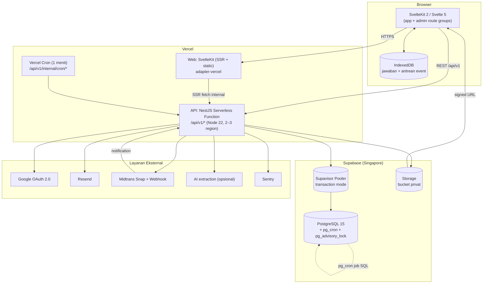

**Penjelasan batas:**

- **Web** hanya render + antrean lokal. Tidak ada business rule, tidak pernah menerima kunci jawaban.
- **API** satu NestJS app yang di-bundle ke satu function (`api/index.ts`). Router Nest tetap modular; `vercel.json` mengarahkan semua `/api/*` ke function tersebut.
- **Cron** adalah endpoint bertanda `CRON_SECRET`, dipanggil Vercel Cron tiap menit. Isinya: finalisasi subtes kedaluwarsa, kirim email outbox, tandai langganan kedaluwarsa, bersihkan token/rate-limit, retry webhook gagal. Setiap job **idempoten + resumable** dan dibatasi ± 50 detik.
- **pg_cron** dipakai untuk pekerjaan murni SQL yang tidak butuh HTTP (partisi tabel, pembersihan rate limit, refresh materialized view statistik).
- **Tidak ada Redis, worker, atau container.** Lock memakai `pg_advisory_xact_lock`; rate limit memakai tabel `rate_limit_hits` dengan UPSERT atomik.

### 4.1 Struktur Repo

```
police-exam/
├─ apps/
│  ├─ api/
│  │  ├─ api/index.ts              # entry Vercel (bootstrap Nest, cached)
│  │  ├─ vercel.json
│  │  ├─ prisma/{schema,migrations,seed}
│  │  └─ src/
│  │     ├─ core/                  # config, prisma, logger, filters, interceptors,
│  │     │                        # guards, decorators, ports/, jobs/, storage/, mail/
│  │     ├─ modules/
│  │     │  ├─ auth/ users/ rbac/ audit/                    # B1
│  │     │  ├─ categories/ questions/ media/ imports/       # B2
│  │     │  │  └─ extractors/{pdf,docx,llm}/
│  │     │  ├─ exams/ proctoring/ scoring/ results/         # B3
│  │     │  └─ plans/ billing/ payments/ entitlements/      # B4
│  │     └─ main.ts
│  └─ web/
│     ├─ vercel.json
│     └─ src/
│        ├─ routes/(auth)/  (app)/  (admin)/
│        ├─ lib/{api,stores,components,schemas,offline}/
│        └─ hooks.server.ts
├─ packages/
│  ├─ contracts/     # Zod + types per domain (subpath export)
│  ├─ ui/            # design system (read-only bagi B2–B4)
│  ├─ mocks/         # MSW handlers + fixture 760 soal
│  └─ config/        # eslint, tsconfig, tailwind preset
├─ supabase/         # config.toml, policies, functions (opsional), cron SQL
├─ .github/workflows/
└─ docs/adr, docs/rfc, docs/runbook
```

---

## 5. Database Design

### 5.1 ERD — Identity & Platform

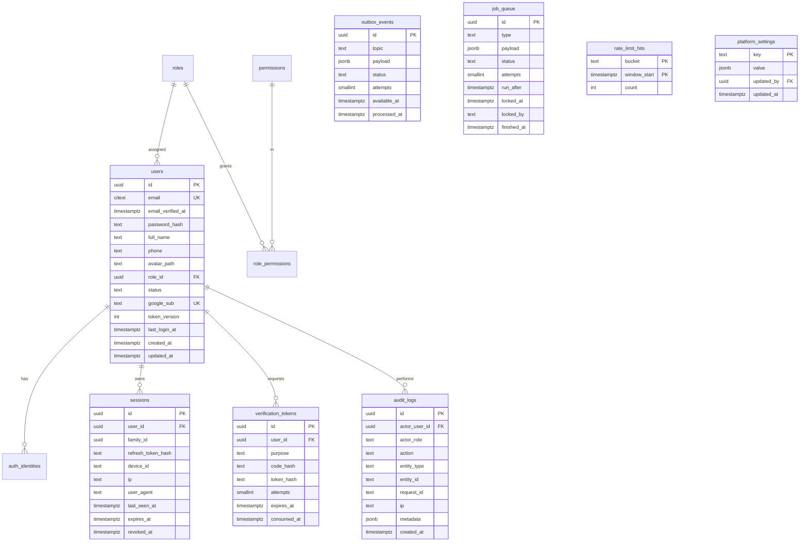

### 5.2 ERD — Question Bank

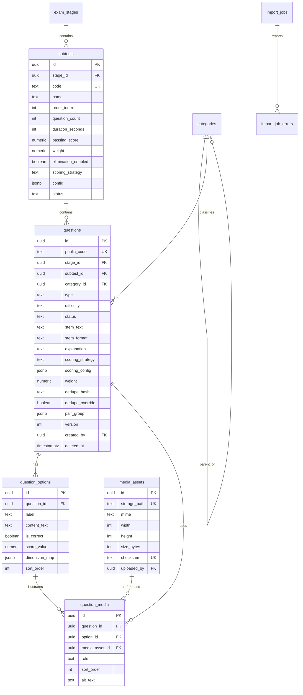

### 5.3 ERD — Examination (dengan subtes, lock, gugur)

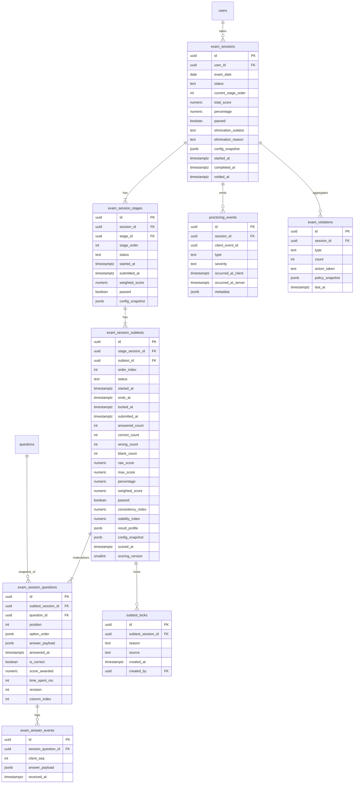

### 5.4 ERD — Billing

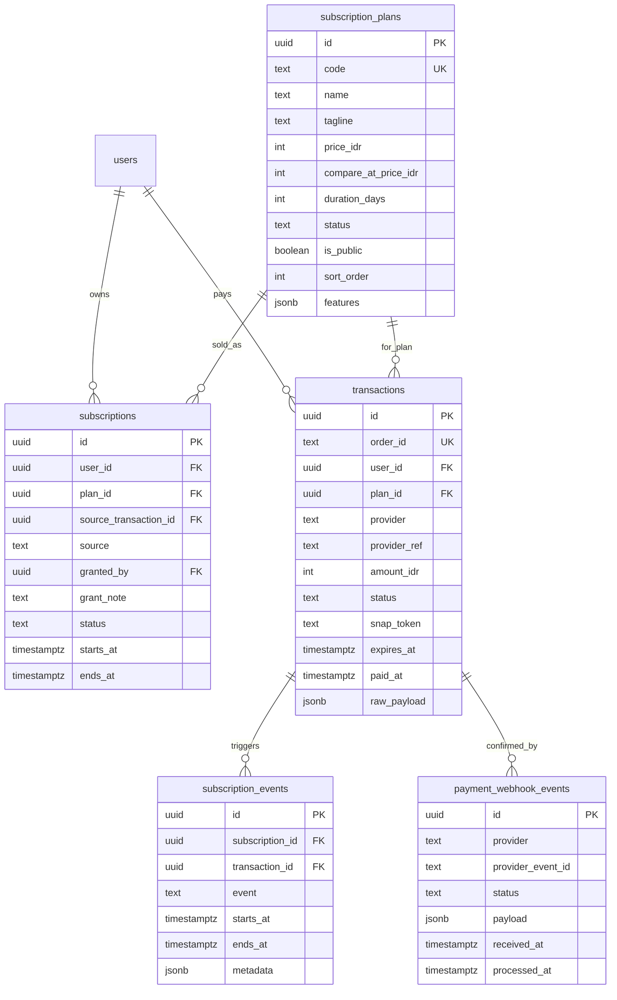

### 5.5 Tabel Kunci, Constraint & Index

| Tabel | Constraint / Index penting |
|---|---|
| `users` | `UNIQUE(email)`; `UNIQUE(google_sub) WHERE google_sub IS NOT NULL`; `INDEX(role_id)` |
| `sessions` | `UNIQUE INDEX one_active_session_per_user ON sessions(user_id) WHERE revoked_at IS NULL`; `INDEX(family_id)` |
| `verification_tokens` | `INDEX(user_id, purpose, expires_at)`; kode disimpan `code_hash` (argon2) |
| `audit_logs` | `INDEX(actor_user_id, created_at DESC)`, `INDEX(entity_type, entity_id)`; append-only, partisi bulanan |
| `job_queue` | `INDEX(status, run_after) WHERE status='pending'`; klaim via `FOR UPDATE SKIP LOCKED`; `INDEX(locked_at)` untuk pemulihan job zombie |
| `rate_limit_hits` | PK `(bucket, window_start)`; pg_cron hapus baris > 1 hari |
| `subtests` | `UNIQUE(code)`; `CHECK(question_count > 0)`, `CHECK(duration_seconds >= 60)`, `CHECK(weight > 0)` |
| `questions` | **`UNIQUE INDEX(stage_id, subtest_id, dedupe_hash) WHERE deleted_at IS NULL AND dedupe_override = false`** (partial, raw SQL); `INDEX(subtest_id, status, difficulty)`; `INDEX(category_id)`; `GIN(to_tsvector('simple', stem_text))` |
| `question_options` | `UNIQUE(question_id, label)`; `INDEX(question_id, sort_order)` |
| `question_media` | `UNIQUE(question_id, option_id, media_asset_id, role)` |
| `media_assets` | `UNIQUE(storage_path)`, `UNIQUE(checksum)` |
| `import_jobs` | `INDEX(admin_id, created_at DESC)`; `INDEX(status)`; kolom `processed_rows`, `total_rows`, `stats jsonb` |
| `exam_sessions` | **`UNIQUE INDEX one_session_per_day ON exam_sessions(user_id, exam_date) WHERE voided_at IS NULL`**; `INDEX(user_id, started_at DESC)`; `INDEX(status)` |
| `exam_session_stages` | `UNIQUE(session_id, stage_order)`; `UNIQUE(session_id, stage_id)` |
| `exam_session_subtests` | **`UNIQUE(session_id, subtest_id)`**, `UNIQUE(session_id, order_index)`; **`INDEX(status, ends_at) WHERE status='ACTIVE'`** untuk cron finalisasi |
| `subtest_locks` | `UNIQUE(subtest_session_id)` → satu subtes hanya punya satu alasan lock final |
| `exam_session_questions` | **`UNIQUE(subtest_session_id, question_id)`**, **`UNIQUE(subtest_session_id, position)`**; `INDEX(subtest_session_id, position)`; untuk Pass Hand: `INDEX(subtest_session_id, column_index, position)` |
| `exam_answer_events` | `UNIQUE(session_question_id, client_seq)` → idempotensi autosave |
| `proctoring_events` | `UNIQUE(session_id, client_event_id)`; partisi bulanan; `INDEX(session_id, type)` |
| `exam_violations` | `UNIQUE(session_id, type)` + counter (UPSERT atomik) |
| `transactions` | `UNIQUE(order_id)`, `UNIQUE(provider, provider_ref)`; `INDEX(user_id, created_at DESC)`; `INDEX(status, expires_at)` |
| `payment_webhook_events` | `UNIQUE(provider, provider_event_id)`; `INDEX(status)` |
| `subscriptions` | `INDEX(user_id, status, ends_at DESC)`; aktif = `status='active' AND now() BETWEEN starts_at AND ends_at` |

**Aturan umum:** PK `uuid` (v7 bila memungkinkan), semua waktu `timestamptz`, skor `numeric(12,4)`, snapshot/config `jsonb`, soft delete hanya pada `questions` & `users`, FK `ON DELETE RESTRICT` kecuali media (SET NULL).

### 5.6 Prisma Multi-File & Ownership

```
apps/api/prisma/schema/
  core.prisma      # users, roles, permissions, sessions, tokens, audit, outbox, job_queue, rate_limit, settings  → B1
  question.prisma  # categories, questions, options, media, imports                                             → B2
  exam.prisma      # stages, subtests, sessions, subtest sessions, locks, proctoring                            → B3
  billing.prisma   # plans, subscriptions, transactions, webhook events                                        → B4
```

- `generator client` + `datasource` hanya di `core.prisma`; nama model unik lintas file.
- Enum lintas-domain (`StageCode`, `SubtestCode`) didefinisikan di `core.prisma` dan **dibekukan pada Phase 0**.
- Migrasi satu folder `prisma/migrations`, prefix `YYYYMMDDHHMMSS_b{n}_{nama}`; hanya owner tabel yang menulis migrasi tabelnya.

---

## 6. Authentication & Authorization

### 6.1 Alur Login + Single Session + Refresh

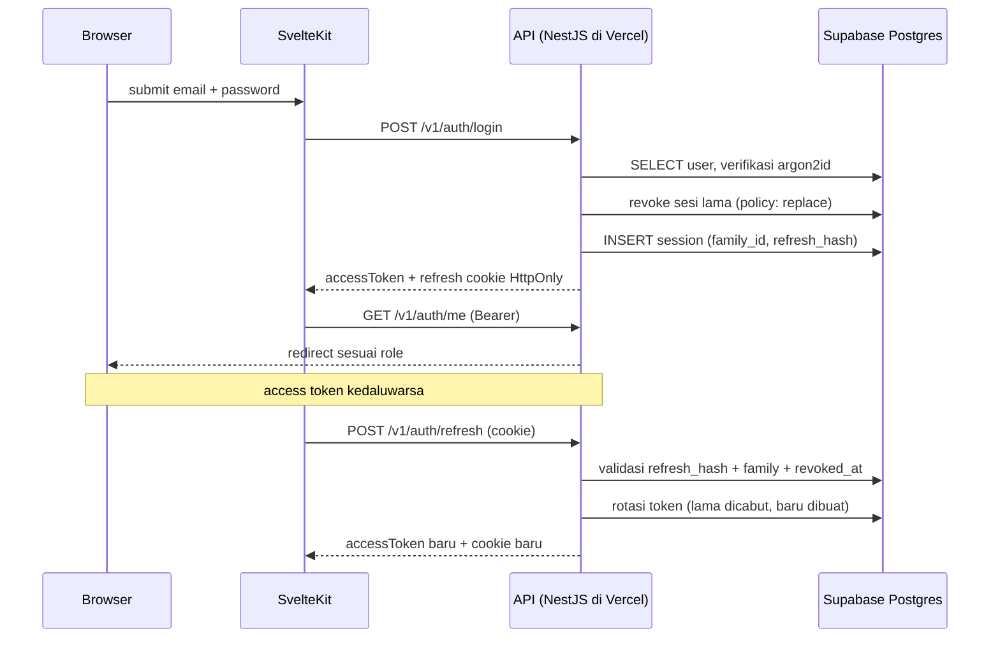

- **Password:** argon2id (memory 19 MiB, iterations 2, parallelism 1). Minimal 10 karakter.
- **Access token:** JWT HS256, klaim `sub`, `sid`, `role`, `ver`, `iat`, `exp` (15 menit), disimpan di **memori** klien.
- **Refresh token:** opaque 256-bit, hash SHA-256 di `sessions`; cookie `HttpOnly; Secure; SameSite=Lax; Path=/v1/auth`; rotasi setiap refresh; **reuse detection** → cabut seluruh family.
- **Single active session:** partial unique index + `SessionGuard` memeriksa `sid` aktif pada setiap request. Login baru saat ujian berjalan: policy `replace` (default) + email notifikasi + `proctoring_event(SESSION_REPLACED)`; sesi ujian tetap milik user.
- **Google OAuth:** authorization code flow server-side, `state` + PKCE, wajib `email_verified`; (a) identitas cocok → login, (b) email terverifikasi cocok → link, (c) baru → buat user terverifikasi.
- **OTP email:** 6 digit, hash argon2, TTL 10 menit, maks 5 percobaan, resend cooldown 60 detik (rate limit di Postgres). Link verifikasi TTL 24 jam, sekali pakai.
- **Reset password:** token TTL 30 menit; setelah sukses `token_version += 1` + cabut semua sesi.
- **Cookies di serverless:** `SameSite=Lax` + cek `Origin`; tidak bergantung pada state in-memory proses (semua state di DB).

### 6.2 RBAC

Guard chain: `JwtAuthGuard → SessionGuard → EmailVerifiedGuard → PermissionsGuard`.

| Permission | USER | ADMIN | SUPER_ADMIN |
|---|---|---|---|
| `exam.take` | ✔ | – | – |
| `questions.read/write/import/publish` | – | ✔ | ✔ |
| `exams.config`, `exams.monitor`, `exams.recompute` | – | ✔ | ✔ |
| `exams.force_unlock` | – | – | ✔ |
| `users.read`, `users.suspend` | – | ✔ | ✔ |
| `users.create`, `users.password.reset` | – | ✔ | ✔ |
| `subscriptions.manage` (grant/extend/revoke manual) | – | ✔ | ✔ |
| `roles.manage` (ubah role user) | – | – | ✔ |
| `settings.write`, `audit.read`, `system.impersonate` | – | – | ✔ |
| `billing.read`, `billing.write` | – | ✔ | ✔ |

Frontend hanya menyembunyikan UI; semua endpoint tetap divalidasi backend. IDOR test wajib di CI (akses resource milik user lain → 404, bukan 403).

---

## 7. Examination Engine — 3 Tes (Psikologi, TPA, TPK)

### 7.1 Hierarki Ujian

```
exam_sessions
└─ exam_session_stages (3 tes: PSIKOLOGI, TPA, TPK)
   ├─ [PSIKOLOGI] exam_session_subtests (KECERDASAN, KEPRIBADIAN, KECERMATAN, PASS_HAND)
   ├─ [TPA]       exam_session_subtests (TPA — satu subtes teknis)
   └─ [TPK]       exam_session_subtests (TPK — satu subtes teknis)
      └─ exam_session_questions (materialisasi + urutan + jawaban)
```

Setiap **tes** adalah `exam_stages`; setiap pengerjaan memiliki `exam_session_stages`. Agar satu jalur kode dipakai untuk timer, lock, autosave, dan scoring, **setiap tes memiliki minimal satu `subtests`**: Psikologi punya 4 subtes nyata, sedangkan TPA dan TPK masing-masing direpresentasikan sebagai **satu subtes teknis** (`TPA`, `TPK`) yang dibuat otomatis dari konfigurasi stage. Dengan begitu `exam_session_questions` **selalu** terikat ke `subtest_session_id`. Menambah seksi baru di masa depan cukup menambah baris `subtests` — tanpa migrasi struktural.

### 7.2 Aturan Emas: Gugur + Hard Lock

| Aturan | Perilaku Sistem |
|---|---|
| **Berurutan** | Subtes hanya bisa dibuka setelah subtes sebelumnya berstatus terminal (`COMPLETED`/`EXPIRED`/`LOCKED`) |
| **Hard lock waktu** | Saat `now() ≥ ends_at`: subtes di-finalisasi server, `status=LOCKED`, `locked_at=now()`, jawaban berikutnya ditolak (`409 EXAM_SUBTEST_LOCKED`). Timer subtes berikutnya **mulai penuh** saat user membukanya (default `on_open`) atau langsung (`immediate`) — dapat dikonfigurasi per stage |
| **Tidak bisa dibuka ulang** | `subtest_locks` mencatat alasan final (`TIME_EXPIRED`, `ELIMINATED`, `VIOLATION`, `ADMIN_FORCE`). Status terminal tidak dapat dikembalikan user; hanya `SUPER_ADMIN` via `POST /admin/exam-sessions/:id/subtests/:subId/unlock` (ber-audit, alasan wajib) |
| **Sistem gugur** | Setelah subtes dinilai: jika `percentage < subtests.passing_score` dan `elimination_enabled=true` → `exam_sessions.status=ELIMINATED`; semua subtes/stage berikutnya `LOCKED` dengan alasan `ELIMINATED`; sesi langsung selesai dan hasil parsial tetap ditampilkan |
| **Gugur tidak membatalkan data** | Jawaban & skor subtes yang sudah dikerjakan tetap tersimpan permanen dan tampil di hasil/riwayat |
| **Tidak ada kompensasi waktu** | Sisa waktu subtes sebelumnya tidak pernah dipindahkan ke subtes berikutnya |
| **Tidak ada "kembali"** | Setelah subtes terminal, user tidak dapat melihat soal lagi (hanya ringkasan skor) |

**Urutan subtes Psikologi & konfigurasi default (dapat diubah admin):**

| Urutan | Subtes | Jumlah | Durasi | Ambang gugur default | Bobot Tes Psikologi |
|---|---|---|---|---|---|
| 1 | `KECERDASAN` | 100 | 120 menit | 60 | 50% |
| 2 | `KEPRIBADIAN` | 140 | 45 menit | 60 (indeks kesesuaian) | 20% |
| 3 | `KECERMATAN` | 500 | 10 menit | 55 (net score) | 20% |
| 4 | `PASS_HAND` | 150 kolom | 18 menit | 50 | 10% |

**Bobot antar-tes terhadap nilai total:** Psikologi 50%, TPA 30%, TPK 20% (default). Setiap tes punya `passing_score` sendiri; gugur pada Psikologi menghentikan TPA/TPK, sedangkan gugur pada TPA/TPK hanya menandai hasil akhir gagal.

**Konfigurasi Tes 2 & 3 (default seed):**

| Tes | Subtes teknis | Jumlah | Durasi | Ambang lulus | Gugur? |
|---|---|---|---|---|---|
| TPA | `TPA` | 100 soal | 90 menit | 60 | Ya (default aktif) |
| TPK | `TPK` | 100 soal | 60 menit | 60 | Tidak (dilaporkan) |

### 7.3 State Machine Subtes

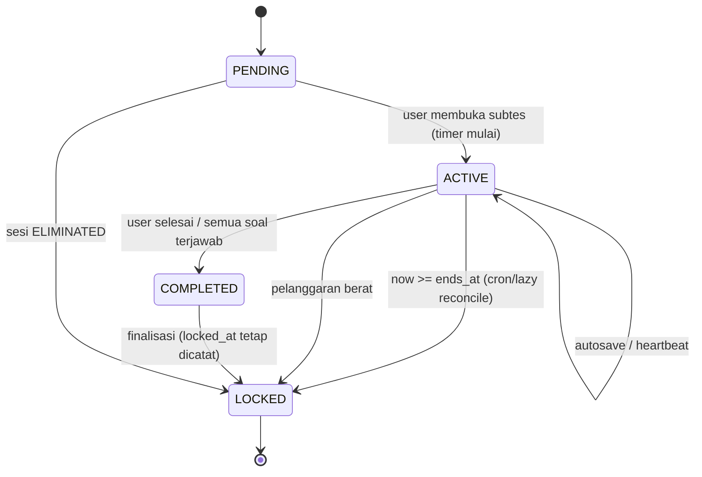

> Catatan implementasi: `COMPLETED` dan `LOCKED` sama-sama terminal. `locked_at` diisi di keduanya agar audit "kapan tepatnya subtes ditutup" tersedia; alasan disimpan di `subtest_locks.reason`.

### 7.4 Finalisasi Subtes (Idempoten)

Dipanggil oleh tiga jalur: (a) request user berikutnya (lazy), (b) `POST .../finish`, (c) cron tiap menit. Semua jalur memakai fungsi yang sama:

```
finalizeSubtest(subtestSessionId):
  BEGIN
    SELECT * FROM exam_session_subtests WHERE id = $1 FOR UPDATE
    IF status IN ('COMPLETED','LOCKED') THEN RETURN existing   -- idempoten
    UPDATE ... SET status='LOCKED', locked_at=now(), submitted_at=now()
    INSERT INTO subtest_locks(reason := now() >= ends_at ? 'TIME_EXPIRED' : 'COMPLETED')
    scoreSubtest(...)   -- hitung benar/salah/kosong, skor, profil, konsistensi
    IF eliminationEnabled AND percentage < passingScore:
       UPDATE exam_sessions SET status='ELIMINATED', elimination_subtest=code, ...
       -- subtes & stage berikutnya dibiarkan PENDING; saat dibuka akan ditolak & di-lock
    ELSE
       buka subtes berikutnya (status PENDING → siap dibuka)
    END IF
  COMMIT
```

- **Lock DB:** `pg_advisory_xact_lock(hashtext(subtest_session_id))` di awal transaksi → dua cron/request paralel tidak menghasilkan double scoring.
- **Cron pattern:** `SELECT ... WHERE status='ACTIVE' AND ends_at <= now() LIMIT 100 FOR UPDATE SKIP LOCKED` lalu finalisasi satu per satu (batch kecil agar < 50 detik).
- **Jaminan:** meskipun cron mati, user yang membuka halaman tetap memicu finalisasi; tidak ada subtes yang bisa dijawab melewati `ends_at`.

### 7.5 Randomisasi & Materialisasi (Backend-Only)

Saat subtes dibuka:

1. **Validasi**: sesi milik user (`user_id` dari token), sesi tidak `ELIMINATED`/`COMPLETED`, subtes `PENDING`, sebelumnya terminal, langganan masih valid untuk stage ini.
2. **Snapshot config** (durasi, jumlah, bobot, ambang, policy, strategi skor) ke `exam_session_subtests.config_snapshot` — perubahan admin tidak memengaruhi sesi berjalan.
3. **Sampling** dalam satu transaksi:
   ```sql
   SELECT id FROM questions
   WHERE subtest_id = $1 AND status = 'published' AND deleted_at IS NULL
   ORDER BY random() LIMIT $2;
   ```
   Pool > 20.000 → `TABLESAMPLE SYSTEM` + fallback loop. Opsional stratifikasi kesulitan sesuai `config.difficultyMix`.
4. **Insert batch** `exam_session_questions` (`position`, `option_order` acak, `column_index` untuk Pass Hand) via `createMany` 500 baris dalam 1 transaksi. Unique constraint `(subtest_session_id, question_id)` = jaminan anti-duplikat; konflik → retry sampling 1×.
5. `status='ACTIVE'`, `started_at=now()`, `ends_at=started_at+duration` (atau `ends_at=NULL` jika policy `on_open` dan subtes belum dibuka — lihat 7.6).

**Kecermatan (500 soal):** soal tidak dikirim sekaligus. Fetch bertahap 50 soal (`?cursor=position`), tetapi seluruh 500 sudah **dimaterialisasi** di awal sehingga klien dapat melakukan prefetch agresif dan tidak ada random tambahan di tengah jalan.

### 7.6 Timer Server-Authoritative

- Kebenaran waktu = `exam_session_subtests.started_at + duration_seconds`. Setiap respons membawa `{ serverTime, endsAt, remainingMs, status }`; klien menghitung `offset` dan mengoreksi drift tiap 10 detik (khusus subtes 10 menit).
- **Policy start subtes berikutnya** (setting `platform_settings.subtestTransition`):
  - `on_open` (default): timer subtes berikut mulai saat user membukanya → adil untuk koneksi putus.
  - `immediate`: timer mulai saat subtes sebelumnya terminal → mencegah user "menyimpan" waktu dengan tidak membuka halaman.
- **Grace period jaringan**: autosave diterima bila `now ≤ ends_at + 3 detik` (subtes 10 menit) / `+ 8 detik` (subtes panjang); nilai jawaban tetap dipotong di `ends_at`, dan `time_spent_ms` diklaim klien divalidasi (`> duration` → ditolak).
- **Hard lock saat habis**: setelah `ends_at`, semua endpoint jawab mengembalikan `409 EXAM_SUBTEST_LOCKED` dengan payload hasil sementara; klien **langsung** menampilkan layar "Subtes Terkunci" dan tidak menunggu cron.
- **Anti-drift klien**: klien yang mencoba menambah waktu sendiri (ubah `remainingMs`) tidak berpengaruh karena server menghitung dari `ends_at` absolut.

### 7.7 Autosave & Recovery

```ts
// PATCH /v1/exams/sessions/:id/subtests/:subId/answers
{
  clientSeq: 128,                 // monotonik per subtes
  answers: [
    { questionId: "uuid", payload: { optionIds: ["uuid"] }, timeSpentMs: 1800 },
    { questionId: "uuid", payload: { text: "7" }, timeSpentMs: 950 }
  ]
}
// 200
{
  serverTime, endsAt, remainingMs, status: "ACTIVE",
  saved: ["uuid"], rejected: [{ questionId: "uuid", code: "SUBTEST_LOCKED" }],
  nextCursor: 250
}
```

- **Debounce adaptif per subtes**: Kecerdasan 800 ms; Kepribadian 600 ms; Kecermatan **batch maks 50 jawaban, flush paling cepat tiap 2 detik** (jawaban tetap tersimpan instan di IndexedDB sehingga tidak ada kehilangan data walau request ditahan); Pass Hand **500 ms** (jawaban per kolom).
- Klien menulis setiap perubahan ke IndexedDB lebih dulu; kirim batch; retry eksponensial 1/2/4/8 detik (maks 5×) dan tetap antre saat offline. Saat tab ditutup/refresh, `sendBeacon` mengirim batch terakhir (best effort) — data tetap aman di IndexedDB.
- Server: transaksi `UPSERT exam_session_questions` + `INSERT exam_answer_events` (unique `client_seq`). Validasi: subtes `ACTIVE`, soal milik subtes, sebelum `ends_at + grace`.
- **Recovery**: `GET /v1/exams/sessions/active` → `{ session, currentStage, currentSubtest, remainingMs, lockedReason, questions? }`. Setelah refresh, jawaban yang belum ter-ACK diambil dari IndexedDB dan dikirim ulang dengan `clientSeq` yang sama (idempoten).

### 7.8 Tipe Soal per Subtes

#### 7.8.1 Kecerdasan (`type: SINGLE_CHOICE | MULTI_CHOICE | IMAGE_CHOICE`)

- 100 soal, MCQ 4–5 opsi, sebagian dengan gambar (pola, kubus, peta).
- Renderer: teks + `srcset` WebP; untuk soal pola visual ada zoom/pan; preload 2 soal berikutnya.
- Skor: `KEYED_CORRECT` (benar 1, salah 0 default).

#### 7.8.2 Kepribadian (`type: LIKERT_STATEMENT`)

- 140 pernyataan, 5 opsi tetap: Sangat Setuju / Setuju / Ragu-ragu / Tidak Setuju / Sangat Tidak Setuju.
- Setiap opsi punya `dimension_map` (mis. `{honesty:+2, impulse_control:+1}`) dan `is_reverse` untuk item terbalik.
- **Soal jebakan/pasangan**: kolom `pair_group` (mis. `PAIR_012`) menghubungkan dua pernyataan setara. Dua-duanya dijawab user; jarak jawaban dipakai menghitung **Consistency Index**:

```
Untuk setiap pair_group dengan 2 item (a, b) yang arah skornya sudah dinormalisasi:
  delta = |norm(a) - norm(b)|          // 0 = konsisten, 4 = paling tidak konsisten
Consistency Index = 100 × (1 - Σdelta / (4 × jumlah_pasangan))
```

- **Indikasi inkonsistensi** (< threshold, default 70) hanya **flag** untuk admin (`result_profile.consistencyFlagged=true`), tidak otomatis menggugurkan kecuali admin menetapkan `elimination_enabled` pada metrik ini.
- Skor subtes = kesesuaian profil terhadap `config.targetProfile` per dimensi (bobot dimensi diatur admin) → `DIMENSION_PROFILE` + `CONSISTENCY_INDEX`.

#### 7.8.3 Kecermatan (`type: MISSING_ELEMENT`)

- 500 soal, tiga varian: `MISSING_DIGIT`, `MISSING_LETTER`, `MISSING_SYMBOL`.
- Struktur soal: dua larik karakter sejajar; larik kedua kehilangan satu karakter. User mengetik karakter hilang (1 ketukan keyboard) atau memilih dari 5 opsi.
- **UI wajib**: tanpa gambar, keyboard-first, auto-focus, `Enter`/ketikan langsung memindahkan ke soal berikutnya, progress bar jumlah terjawab, tidak ada animasi yang memperlambat.
- **Arsitektur performa**: 500 soal dimaterialisasi di awal; klien mengambil blok 50, menyimpan ke IndexedDB, render virtualized (hanya 1 soal tampil); jawaban dikirim dalam batch hingga 50 jawaban dengan jeda minimal 2 detik antar request (throttle agar serverless tetap aman).
- **Skor**: `CORRECT_MINUS_PENALTY` → `raw = correct − (penalty × wrong)`, `penalty` default 1, `blank` = 0, lalu dikonversi ke skala 0–100: `percentage = clamp(raw / question_count × 100, 0, 100)`.
- **Tidak menuntut selesai**: `blank_count` besar adalah normal; laporan menampilkan `attempted`, `correct`, `wrong`, `accuracy`, `throughput (soal/menit)`.

#### 7.8.4 Pass Hand / Kraepelin–Pauli (`type: PASS_HAND_COLUMN`)

- 150 kolom; tiap kolom berisi deret angka bertumpuk ke bawah (default 20 baris, dapat dikonfigurasi). User menjumlahkan dua angka berdekatan dan menuliskan **digit terakhir** hasilnya.
- **Alur**: satu kolom tampil penuh; jawaban per pasangan; setelah baris terakhir kolom, otomatis lanjut ke kolom berikutnya dan mencatat `column_time_ms`.
- **Data**: `exam_session_questions.column_index` menyimpan indeks kolom; `answer_payload = { "values": ["7","3",...] }` (satu nilai per pasangan) agar satu baris DB per kolom (150 baris, bukan 3.000).
- **Metrik (strategi `PASS_HAND_METRIC`)**:
  ```
  completedColumns  = jumlah kolom dengan semua pasangan terisi
  totalPairs        = Σ pasangan terjawab
  correctPairs      = jumlah pasangan benar
  accuracy          = correctPairs / totalPairs
  throughput        = totalPairs / elapsedMinutes
  stability         = 100 × (1 - stdev(column_time_ms) / mean(column_time_ms))   // 0..100
  trend             = slope regresi linier column_time_ms terhadap indeks kolom
  rawScore          = w1×(accuracy×100) + w2×throughputScore + w3×stability
  ```
  `w1/w2/w3` default `0.5/0.25/0.25`, `throughputScore` dinormalisasi terhadap `maxPairsPerMinute` di config.
- **Grafik kerja** disimpan (`result_profile.columnSeries`) untuk ditampilkan di halaman hasil: naik-turun drastis → `stability` rendah (indikasi kontrol emosi lemah), bukan vonis otomatis.

### 7.9 Scoring & Agregasi

| Strategi | Perilaku | Dipakai |
|---|---|---|
| `KEYED_CORRECT` | benar = `score_value` (default 1), salah = `penalty` (default 0), kosong = 0 | Kecerdasan, TPA, TPK |
| `MULTI_CORRECT_PARTIAL` | skor parsial proporsional / penalti sesuai `scoring_config` | soal multi-jawaban |
| `WEIGHTED_OPTIONS` | tiap opsi punya `score_value` | varian Likert sederhana |
| `DIMENSION_PROFILE` | opsi memetakan vektor dimensi; skor = kesesuaian profil target | Kepribadian |
| `CONSISTENCY_INDEX` | mengukur konsistensi pasangan jebakan; menghasilkan flag | Kepribadian (pendamping) |
| `CORRECT_MINUS_PENALTY` | `correct − penalty×wrong` dengan clamp 0 | Kecermatan |
| `PASS_HAND_METRIC` | akurasi + throughput + stabilitas + tren | Pass Hand |
| `MANUAL_REVIEW` | skor 0 + flag review admin | esai (future) |

Agregasi:

```
percentage_subtest = clamp(rawScore_subtest / maxScore_subtest × 100, 0, 100)
weighted_subtest   = percentage_subtest × (subtest.weight / 100)
percentage_stage1  = Σ weighted_subtest

percentage_stage{2,3} = rawScore / maxScore × 100
total                 = Σ (percentage_stage_n × stage_n.weight / 100)
passed                = (tidak ELIMINATED) AND total ≥ total_passing_grade
                        AND setiap stage.passed (≥ stage.passing_grade) jika diaktifkan
```

- Dihitung saat subtes/stage ditutup; `scored_at` + `scoring_version` mencegah double scoring; recompute admin menulis versi baru tanpa mengubah jawaban.
- Pembulatan 2 desimal `ROUND_HALF_UP` di satu util bersama.
- Soal dianulir (`question.annulled=true`) → recompute menyesuaikan `maxScore`, tercatat di audit.

### 7.10 Batas Harian & Pemulihan

- `exam_date` dihitung dari `platform_settings.timezone` (default `Asia/Jakarta`) → partial unique index menolak sesi kedua di hari yang sama, termasuk saat request paralel.
- Sesi `IN_PROGRESS` yang ditinggalkan tetap hidup; timer tetap berjalan di server. User tidak bisa memulai sesi baru.
- `CREATED` yang tidak pernah dimulai > 30 menit → cron menandai `ABANDONED` (tidak memblokir kuota).
- Admin `POST /admin/exam-sessions/:id/void` membebaskan kuota hari itu (ber-audit); `voided_at` dikecualikan dari index unik.

---

## 8. Anti-Cheating

| Lapisan | Mekanisme | Penanganan server |
|---|---|---|
| Klien (sinyal saja) | `visibilitychange`, `blur`, `copy/cut/paste`, `contextmenu`, `fullscreenchange`, `beforeunload`, `keydown` (F12/Ctrl+Shift+I), ukuran window anomali | Batch ke `POST /events`; server dedupe `session_id + client_event_id`; klien hanya menampilkan peringatan dari server |
| Heartbeat | 20 detik; hilang > 60 detik | `HEARTBEAT_LOST` severity low; 3× → medium |
| Waktu jawaban | `time_spent_ms` dari klien, divalidasi server | Anomali (< 300 ms untuk soal bergambar; Kecermatan < 150 ms/soal beruntun) → flag, bukan sanksi otomatis |
| Sesi | Login baru saat ujian, perubahan IP/UA mid-session | `SESSION_REPLACED` / `ENVIRONMENT_CHANGED` |
| Integritas data | Kunci jawaban tidak pernah dikirim; cek kepemilikan sesi; terminal lock; timer server | 404/409 terstruktur |
| Pola (fase 2) | Kesamaan pola jawaban antar peserta (job harian, cosine similarity) | Laporan admin |

**Policy pelanggaran** (`platform_settings.violationPolicy`, snapshot per sesi):

```json
{
  "events": {
    "TAB_BLUR":       { "severity": "low",    "actions": [{ "at": 3, "action": "WARN" }, { "at": 6, "action": "LOCK_SUBTEST" }] },
    "COPY_PASTE":     { "severity": "medium", "actions": [{ "at": 1, "action": "WARN" }, { "at": 3, "action": "ELIMINATE" }] },
    "FULLSCREEN_EXIT":{ "severity": "low",    "actions": [{ "at": 4, "action": "WARN" }] },
    "HEARTBEAT_LOST": { "severity": "low",    "actions": [{ "at": 5, "action": "WARN" }] }
  },
  "warningTemplate": "Pelanggaran {type} terdeteksi ({count}/{limit})."
}
```

Aksi: `WARN` (respons + overlay), `LOCK_SUBTEST` (subtes sekarang ditutup, alasan `VIOLATION`), `ELIMINATE` (sesi gugur, hasil parsial tetap disimpan), `LOCK_ACCOUNT` (SUPER_ADMIN saja). Semua aksi dieksekusi backend, dicatat di `exam_violations` + `audit_logs`.

**Batasan yang diakui** (ditampilkan sebelum ujian): browser tidak dapat mencegah screenshot, perangkat kedua, atau penutupan paksa. Nilai utama ada pada audit trail, korelasi waktu server, deteksi pola, dan review admin.

---

## 9. Pricing, Subscription & Payment Gateway

> **Status implementasi:** payment gateway (**Midtrans**) **sudah terpasang**, tetapi **halaman pricing belum ada**. Bagian ini menetapkan struktur paket, **desain halaman pricing**, dan alur checkout yang memakai gateway tersebut. Angka harga adalah **usulan awal** yang disimpan di database (bukan hardcode) sehingga bisa diubah admin kapan saja tanpa deploy. Pembayaran **tidak wajib** untuk semua user: admin dapat mengaktifkan langganan secara manual (§9.5).

### 9.1 Struktur Pricing (default seed, dapat diubah admin)

| Kode | Nama Paket | Durasi | Harga (IDR) | Isi | Status |
|---|---|---|---|---|---|
| `TRIAL_3D` | Trial 3 Hari | 3 hari | 0 | 1 sesi ujian/hari, semua 3 tes, hasil lengkap | Aktif (opsional, 1×/akun) |
| `WEEKLY` | Paket Mingguan | 7 hari | 49.000 | 1 sesi ujian/hari, semua 3 tes, riwayat + statistik | Aktif |
| `BIWEEKLY` | Paket 2 Minggu | 14 hari | 89.000 | Sama + pembahasan soal | Aktif |
| `MONTHLY` | Paket Bulanan | 30 hari | 149.000 | Sama + prioritas dukungan | Aktif (paling populer) |
| `QUARTERLY` | Paket 3 Bulan | 90 hari | 399.000 | Sama + hemat 11% | Aktif |
| `CUSTOM` | Paket Khusus | bebas | ditentukan admin | Untuk instansi/sekolah | Tidak tampil publik |

**Aturan pricing:**

- `subscription_plans` menyimpan `price_idr`, `compare_at_price_idr` (harga coret), `duration_days`, `features[]`, `is_public`, `sort_order`.
- Harga **selalu** diambil ulang dari DB saat checkout — nominal dari klien tidak pernah dipercaya.
- Promo/diskon: `discount_code` (opsional, fase 2) memotong `amount_idr` sebelum membuat transaksi; dicatat di `transactions.raw_payload`.
- Halaman publik `(app)/pricing` menampilkan paket aktif dari `GET /plans`; admin mengelola di `(admin)/plans`.
- Perubahan harga **tidak** mengubah transaksi yang sudah ada (snapshot `amount_idr` di transaksi).

### 9.2 Payment Gateway

| Aspek | Keputusan |
|---|---|
| Gateway utama | **Midtrans Snap** (QRIS, Virtual Account BCA/BNI/BRI/Mandiri, GoPay, ShopeePay, kartu kredit, gerai retail) |
| Gateway alternatif | Di belakang `PaymentProvider` port; Xendit dapat ditambah tanpa mengubah domain |
| Mode | Sandbox untuk `local`/`preview`/`staging`, Production untuk `production` |
| Kredensial | `MIDTRANS_SERVER_KEY`, `MIDTRANS_CLIENT_KEY`, `MIDTRANS_IS_PRODUCTION` — hanya di env server |
| Idempotency | `order_id` unik per transaksi + `UNIQUE(provider, provider_event_id)` |
| Retry | Webhook gagal masuk `job_queue`, di-retry cron dengan backoff; status akhir tetap dari webhook resmi |
| Rekonsiliasi | Cron harian membandingkan transaksi `PENDING` > 24 jam dengan status Midtrans |

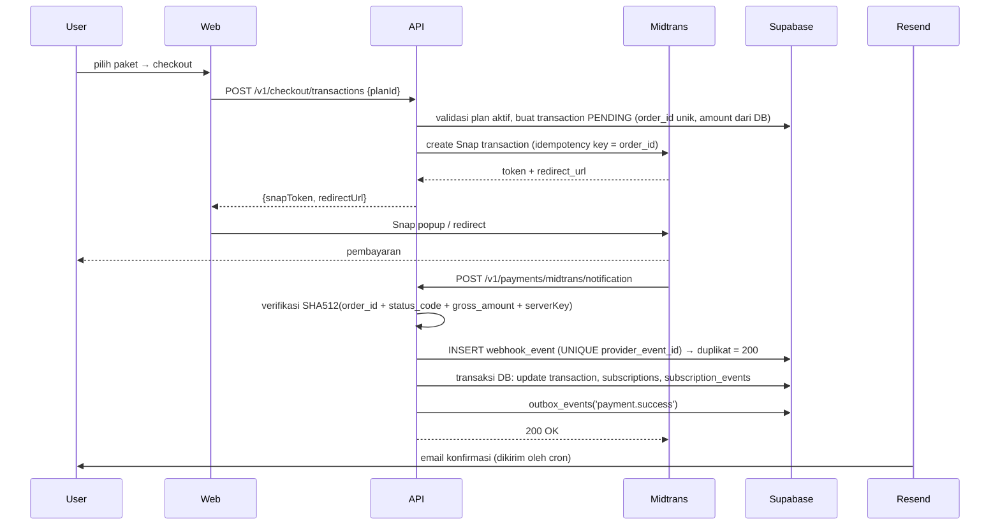

- **Status mapping:** `pending`→`PENDING`; `settlement`/`capture`→`SUCCESS`; `expire`→`EXPIRED`; `deny`/`failure`→`FAILED`; `cancel`→`CANCELLED`; `refund`→`REFUNDED`.
- **Idempotensi:** `UNIQUE(provider, provider_event_id)` + `SELECT ... FOR UPDATE` pada transaksi + cek `status='PENDING'` sebelum aktivasi. Request berulang → 200 tanpa efek ganda.
- **Perpanjangan:** jika masih aktif, `starts_at = max(now, existing.ends_at)`, `ends_at = starts_at + duration_days` (stacking).
- **Expiry:** cron harian menandai `expired` + email H-3 dan H-0.
- **Webhook di serverless:** wajib verifikasi signature, validasi `gross_amount` vs DB, tolak `transaction_id` tak dikenal; tidak mempercayai status dari return URL. Karena Vercel tidak menjamin urutan, event diproses murni berdasarkan `transaction_status` + idempotency.
- **Abstraksi:** `PaymentProvider` (`createCharge`, `verifyWebhook`, `parseEvent`, `refund?`). Implementasi `MidtransProvider`; `FakeProvider` untuk dev/test (signature valid lokal, `POST /internal/payments/fake/settle`).
- **Tanpa gateway (fallback operasional):** admin dapat mengaktifkan langganan manual (§9.5) — berguna untuk pembayaran transfer bank, instansi, atau kompensasi gangguan.

### 9.3 Halaman & UX

| Halaman | Isi |
|---|---|
| `(app)/pricing` | Kartu paket, harga coret, daftar fitur, CTA "Pilih Paket" |
| `(app)/checkout` | Ringkasan paket, total, tombol Snap, status pembayaran (polling ringan) |
| `(app)/subscription` | Status aktif, sisa hari, tanggal berakhir, tombol perpanjang |
| `(app)/transactions` | Riwayat transaksi + status + invoice |
| `(admin)/plans` | CRUD paket & harga, toggle publik, urutan tampil |
| `(admin)/transactions` | Semua transaksi, filter status, mark-paid/refund |
| `(admin)/users/:id` | Tab langganan: **beri/perpanjang/cabut** dengan durasi kustom |

**Invoice:** setiap transaksi `SUCCESS` menghasilkan nomor invoice (`INV/YYYY/MM/<urut>`), dapat diunduh PDF sederhana (fase 2; fase 1 cukup halaman HTML yang bisa dicetak).

### 9.4 Gating Ujian

`AccessPolicyPort.assertCanStartExam(userId)` = langganan aktif (pembelian **atau** grant manual admin) + belum ada sesi hari ini; dipanggil saat buat sesi **dan** saat membuka TPA/TPK (langganan bisa habis di tengah ujian → tes berikutnya ditolak dengan pesan jelas).

### 9.5 Grant Langganan Manual oleh Admin

- Endpoint: `POST /admin/subscriptions` dengan `{ userId, planId?, durationDays, startsAt?, reason }`; `durationDays` 1–3650.
- Jika user sudah punya langganan aktif → **stacking** (`starts_at = max(now, ends_at)`), kecuali `mode=REPLACE` dipilih admin (dicatat di audit).
- `subscriptions.source = 'MANUAL_GRANT'`, `granted_by`, `grant_note`; muncul di riwayat user sebagai "Diberikan admin".
- Bisa dicabut (`PATCH /admin/subscriptions/:id` → `REVOKED`) dengan alasan wajib; tidak menghapus riwayat.
- Semua aksi menulis `audit_logs` (`SUBSCRIPTION_GRANT`, `SUBSCRIPTION_EXTEND`, `SUBSCRIPTION_REVOKE`) + mengirim email ke user.

### 9.6 Pembuatan User oleh Admin

- `POST /admin/users` → buat user `PENDING_INVITE`, kirim email undangan (token 7 hari) untuk membuat password.
- Admin **tidak** melihat/menyimpan password user; opsional "buat password sementara" yang wajib diganti saat login pertama (`must_change_password=true`).
- Saat membuat user, admin dapat langsung menyertakan `subscription: { planId | durationDays }` sehingga user bisa langsung ujian.
- User hasil provisioning tetap dapat login via Google OAuth dengan email yang sama (akun ter-link otomatis).

---

## 10. Question Management, Bulk & Document Import

### 10.1 Model Konten

- `questions.type`: `SINGLE_CHOICE`, `MULTI_CHOICE`, `IMAGE_CHOICE`, `LIKERT_STATEMENT`, `MISSING_ELEMENT`, `PASS_HAND_COLUMN`.
- Gambar tidak menjadi kolom: direlasikan lewat `question_media` (`role ∈ {STEM, OPTION, EXPLANATION}`, `option_id` nullable).
- `stem_format`: `MARKDOWN` (disarankan, disanitasi) atau `HTML` (whitelist tag ketat).
- Tipe baru = tambah `type` + strategi skor + renderer di registry (`packages/contracts` + web renderer). Tanpa migrasi struktur.

### 10.2 Single Input

Wizard 3 langkah: **Konten** (subtes, kategori, tipe, stem, gambar, opsi/kunci) → **Pengaturan** (kesulitan, bobot, strategi skor, `pair_group` untuk Kepribadian, `column_index` untuk Pass Hand) → **Preview** (render identik dengan runner). Validasi Zod di klien (UX) + DTO class-validator (kebenaran). Draft autosave 10 detik.

### 10.3 Import Spreadsheet (CSV/XLSX + ZIP gambar)

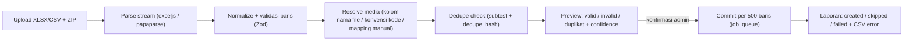

- **Kolom template:** `public_code, stage_code, subtest_code, category_path, type, difficulty, stem_text, option_a..option_e, correct_labels ("A" atau "A,C"), likert_dimension, pair_group, explanation, scoring_strategy, weight, image_stem_1..3, image_opt_a..e`.
- **Mapping gambar:** (1) nama file di sel; (2) konvensi `Q{public_code}_stem_1.png` / `Q{public_code}_opt_A.png`; (3) UI drag-and-drop manual.
- **Validasi:** png/jpeg/webp hanya (SVG ditolak), ≤ 5 MB/gambar, dimensi ≥ 200×200, `correct_labels` merujuk opsi yang ada, `pair_group` unik berpasangan untuk Likert.
- **Dedupe:** `sha256(lower(trim(strip(stem))) + '|' + sorted(normalized option texts))`; duplikat dalam file maupun DB dilaporkan; default `skip`, admin bisa `override` (`dedupe_override=true`).
- **Skala:** maks 5.000 baris/job; upload langsung ke Storage via signed upload URL; commit per 500 baris di `job_queue` (resumable, bisa dibatalkan).

### 10.4 Import dari PDF & Word (FR-QB-9/10/11/12)

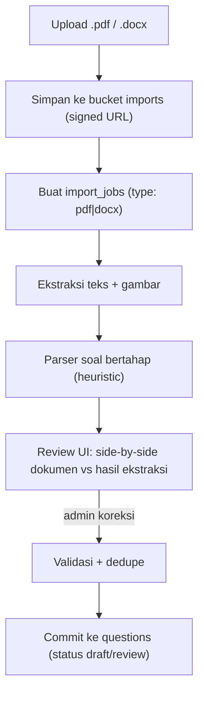

**A. Ekstraksi**

| Format | Library | Catatan |
|---|---|---|
| PDF (digital) | `unpdf` (pdf.js headless) | Ambil teks per baris + posisi; render halaman ke PNG (150 dpi) bila perlu OCR/gambar |
| PDF (scan) | OCR opsional (Tesseract/Google Vision/LLM vision) | Ditandai `ocr_required`; hasil confidence lebih rendah |
| DOCX | `mammoth` (HTML) + `jszip` untuk gambar inline | Mempertahankan heading, penomoran, tabel, dan gambar |
| DOC (lama) | **Tidak didukung** — minta konversi ke DOCX | Menghindari dependensi LibreOffice di serverless |

**B. Parser soal (heuristic, berlapis)**

1. **Deteksi blok soal**: regex nomor (`^\s*(\d{1,3})[\.\)]\s`), jarak baris, heading subtes (`KECERDASAN`, `KEPRIBADIAN`, `KECERMATAN`, `PASS HAND`), dan pemisah halaman.
2. **Deteksi opsi**: `^\s*([A-Ea-e])[\.\)]\s` atau tabel 2 kolom; opsi yang tidak terdeteksi → masuk `warnings`.
3. **Deteksi kunci jawaban**: pola `Jawaban\s*[:=]\s*([A-E])`, `Kunci\s*[:=]`, blok kunci di akhir dokumen (`1. A  2. C ...`), atau highlight/bold (dari DOCX run properties).
4. **Deteksi pembahasan**: `Pembahasan\s*[:=]` sampai nomor soal berikutnya.
5. **Deteksi gambar**: gambar di antara stem dan opsi → `STEM`; gambar setelah label opsi → `OPTION` dengan `option_label`.
6. **Subtes & tipe**: dari heading dokumen, atau dipilih admin di langkah review (`target_subtest`), dengan fallback: 5 opsi Likert → `LIKERT_STATEMENT`; pola "… hilang" → `MISSING_ELEMENT`; deret angka bertumpuk → `PASS_HAND_COLUMN`.

**C. Confidence & review (wajib)**

| Field | Bobot confidence |
|---|---|
| Nomor soal terdeteksi | 0,2 |
| ≥ 2 opsi terdeteksi & label berurutan | 0,25 |
| Kunci jawaban terdeteksi & valid | 0,3 |
| Subtes & tipe konsisten dengan heading | 0,15 |
| Tidak ada peringatan parser | 0,1 |

- Item dengan confidence < 0,75 **tidak bisa** masuk `published`; masuk `draft` dan disorot di review UI.
- Review UI: panel kiri render halaman dokumen (PDF.js / HTML DOCX), panel kanan form hasil ekstraksi yang bisa diedit; navigasi per item; bulk-fix untuk pola berulang.
- **Tidak ada auto-publish** dari dokumen; maksimal sampai `review`.

**D. AI assist (opsional, di balik flag `IMPORT_AI_ENABLED`)**

- Dipakai hanya untuk memetakan teks bebas → struktur (stem/opsi/kunci/pembahasan) saat heuristic gagal.
- Provider abstrac: `DocExtractorPort` + `AiStructurerPort`. Default `null` (tanpa AI).
- **Privasi:** hanya potongan dokumen yang dikirim (tanpa metadata user); tidak ada penyimpanan permanen di provider; hasil selalu `draft`.
- Biaya & rate limit diatur admin (maks halaman/job).

**E. Batasan jujur yang harus ditampilkan di UI**

- PDF hasil scan berkualitas rendah, tabel multi-kolom, dan rumus matematika kompleks **pasti** butuh koreksi manual.
- Target realistis: 85–95% item ter-ekstraksi otomatis untuk dokumen yang formatnya konsisten; 60–80% untuk dokumen campuran.
- Import dokumen **selalu** menghasilkan draft, bukan publish.

### 10.5 UX Admin Bank Soal

- Tabel soal: filter subtes/kategori/tipe/status/kesulitan, full-text search, bulk action (publish/archive/delete), thumbnail, pagination cursor, target 1.000 baris ter-render < 1 detik (virtual list).
- Statistik: jumlah published per subtes vs kebutuhan (mis. Kecerdasan butuh ≥ 100; Kecermatan ≥ 500 agar satu sesi penuh tanpa pengulangan) dan peringatan jika pool kurang.

---

## 11. File Storage Architecture

| Bucket | Isi | Akses |
|---|---|---|
| `exam-media` | gambar soal/opsi/pembahasan | **private**; signed URL TTL 30 menit (diperbarui per batch fetch) |
| `avatars` | foto profil | private; signed URL 1 jam |
| `imports` | XLSX/CSV/ZIP/PDF/DOCX + laporan error | private; signed URL 15 menit, hanya admin |
| `exports` | ekspor admin | private; TTL 24 jam |

- Service role key **hanya** di backend (env Vercel); tidak pernah ke browser.
- Upload admin: API membuat signed upload URL → browser upload langsung ke Storage → API memverifikasi objek (`head`, mime, ukuran, checksum) sebelum mencatat `media_assets`.
- Path: `{stage}/{subtest}/{yyyy}/{mm}/{uuid}.webp` — tanpa informasi sensitif.
- Retensi: media yatim > 30 hari dibersihkan cron mingguan; `imports` dihapus setelah 30 hari.
- CSP membatasi `img-src` ke domain Supabase.
- **Ukuran & serverless:** file > 4 MB tidak melewati function (Vercel body limit); wajib direct-to-storage.

---

## 12. API Specification

Base `/api/v1`. Auth `Authorization: Bearer`. Waktu ISO-8601 UTC.

Envelope: `{ "success": true, "data": …, "meta": {…}, "error": null, "requestId": "…" }`
Error: `{ "success": false, "data": null, "error": { "code": "EXAM_SUBTEST_LOCKED", "message": "…", "details": {…} } }`

Pagination: `?limit=50&cursor=…` → `meta: { nextCursor, hasMore }`. Semua ID UUID.

### 12.1 Auth & Users (B1)

| Method | Path | Akses | Fungsi |
|---|---|---|---|
| POST | `/auth/register` | publik | Daftar email+password, kirim OTP |
| POST | `/auth/verify-email` | publik | Verifikasi OTP/token |
| POST | `/auth/resend-verification` | publik | Kirim ulang (rate limited) |
| POST | `/auth/login` | publik | Login, set cookie refresh |
| POST | `/auth/refresh` | cookie | Rotasi token |
| POST | `/auth/logout` · `/auth/logout-all` | user | Cabut sesi |
| POST | `/auth/forgot-password` · `/auth/reset-password` | publik | Reset |
| GET | `/auth/google` · `/auth/google/callback` | publik | OAuth |
| GET | `/auth/sessions` · DELETE `/auth/sessions/:id` | user | Device mgmt |
| GET | `/auth/me` | user | Profil + permission |
| GET/PATCH | `/users/me` · PATCH `/users/me/password` · POST `/users/me/avatar` | user | Profil |
| GET | `/admin/users` · `/admin/users/:id` | admin | Manajemen user |
| POST | `/admin/users` | admin | **Buat akun user manual** (nama, email, telepon) + kirim undangan aktivasi |
| POST | `/admin/users/:id/reset-password` | admin | Kirim link reset password ke user |
| PATCH | `/admin/users/:id/status` · `/admin/users/:id/role` | admin/super | Suspend / ubah role |
| POST | `/admin/subscriptions` | admin | **Grant langganan manual**: `{userId, planId?, durationDays, startsAt?, reason}` |
| PATCH | `/admin/subscriptions/:id` | admin | Perpanjang / ubah tanggal akhir / cabut (alasan wajib) |
| GET | `/admin/subscriptions` | admin | Daftar langganan + filter aktif/akan habis |
| POST | `/admin/users/:id/quota-reset` | admin | Bebaskan kuota harian (audit) |
| GET | `/admin/audit-logs` | super | Audit |
| GET/PATCH | `/admin/settings` | super | Konfigurasi platform |

### 12.2 Questions (B2)

| Method | Path | Akses | Fungsi |
|---|---|---|---|
| GET/POST/PATCH/DELETE | `/admin/categories[/:id]` | admin | Kategori hierarkis |
| GET/POST | `/admin/questions` | admin | List (filter/cursor) / create |
| GET/PATCH/DELETE | `/admin/questions/:id` | admin | Detail / update / soft-delete |
| POST | `/admin/questions/:id/publish` · `/admin/questions/bulk-action` | admin | Publikasi massal |
| POST | `/admin/questions/:id/media` · DELETE `…/media/:mediaId` | admin | Attach/detach media |
| POST | `/admin/media/upload-url` · `/admin/media/confirm` · GET `/admin/media` | admin | Upload langsung |
| POST | `/admin/imports` | admin | Buat job import (spreadsheet/dokumen) |
| GET | `/admin/imports` · `/admin/imports/:id` | admin | Daftar & status/progress |
| POST | `/admin/imports/:id/preview` | admin | Parse + validasi tanpa commit |
| POST | `/admin/imports/:id/commit` · `/cancel` | admin | Commit bertahap / batalkan |
| GET | `/admin/imports/:id/errors.csv` | admin | Laporan error |
| GET | `/admin/imports/template.xlsx` | admin | Template spreadsheet |
| GET | `/admin/questions/stats` | admin | Coverage per subtes |

### 12.3 Exams (B3)

| Method | Path | Akses | Fungsi |
|---|---|---|---|
| GET | `/exams/eligibility` | user | Alasan boleh/tidak mulai |
| POST | `/exams/sessions` | user | Mulai sesi (validasi + materialisasi) |
| GET | `/exams/sessions/active` | user | Resume state (subtes aktif, lock, sisa waktu) |
| GET | `/exams/sessions/:id` | owner | Ringkasan sesi |
| POST | `/exams/sessions/:id/stages/:stageId/subtests/:subId/open` | owner | Buka subtes (mulai timer, materialisasi) |
| GET | `/exams/sessions/:id/subtests/:subId/questions` | owner | Batch soal + signed media, **tanpa kunci** |
| PATCH | `/exams/sessions/:id/subtests/:subId/answers` | owner | Autosave batch |
| POST | `/exams/sessions/:id/subtests/:subId/finish` | owner | Selesai lebih awal |
| POST | `/exams/sessions/:id/heartbeat` | owner | Sinkron waktu + status lock |
| POST | `/exams/sessions/:id/events` | owner | Batch proctoring |
| GET | `/exams/sessions/:id/result` | owner | Hasil lengkap per subtes (setelah selesai/gugur) |
| GET | `/exams/history` · `/exams/stats` | user | Riwayat + tren |
| GET/PATCH | `/admin/exam-stages[/:id]` | admin | Konfigurasi stage |
| GET/POST/PATCH | `/admin/subtests[/:id]` | admin | Konfigurasi 4 subtes (jumlah, durasi, ambang, bobot) |
| GET/PATCH | `/admin/exam-settings` | admin | Passing grade total, timezone, policy transisi |
| GET | `/admin/exam-sessions` · `/admin/exam-sessions/:id` | admin | Monitoring + detail pelanggaran |
| POST | `/admin/exam-sessions/:id/void` · `/recompute` | admin | Void / hitung ulang |
| POST | `/admin/exam-sessions/:id/subtests/:subId/unlock` | **super** | Force unlock (alasan wajib, audit) |
| GET | `/admin/dashboard/exams` | admin | Statistik per subtes |

### 12.4 Billing (B4)

| Method | Path | Akses | Fungsi |
|---|---|---|---|
| GET | `/plans` | publik | Paket aktif |
| GET | `/subscriptions/me` · `/subscriptions/me/history` | user | Status & riwayat |
| POST | `/checkout/transactions` | user | Buat transaksi + Snap |
| GET | `/transactions` · `/transactions/:id` | owner | Riwayat |
| POST | `/payments/midtrans/notification` | publik+signature | Webhook |
| GET | `/payments/midtrans/finish` | publik | Return URL → redirect web |
| GET/POST/PATCH | `/admin/plans[/:id]` | admin | Paket |
| GET | `/admin/transactions` · `/admin/transactions/:id` | admin | Transaksi |
| POST | `/admin/transactions/:id/mark-paid` · `/refund` | admin | Rekonsiliasi manual |
| POST | `/admin/subscriptions/:id/extend` · `/cancel` | admin | Koreksi langganan |
| GET | `/admin/dashboard/revenue` | admin | KPI revenue |

### 12.5 Internal (cron & kesehatan)

| Method | Path | Proteksi | Fungsi |
|---|---|---|---|
| GET | `/health/live` · `/health/ready` | publik | Health check |
| POST | `/internal/cron/finalize-subtests` | `CRON_SECRET` | Lock subtes kedaluwarsa + scoring |
| POST | `/internal/cron/process-jobs` | `CRON_SECRET` | Outbox email, commit import, retry webhook |
| POST | `/internal/cron/expire-subscriptions` | `CRON_SECRET` | Tandai langganan habis + email |
| POST | `/internal/cron/cleanup` | `CRON_SECRET` | Rate limit, token kedaluwarsa, media yatim |
| POST | `/internal/payments/fake/settle` | dev-only | Simulasi webhook |

**Rate limit (Postgres token bucket):** login 5/menit/IP; OTP 3/10 menit/email; register 3/jam/IP; autosave 60/menit/subtes (Kecermatan 60/menit, batch hingga 50 jawaban); events 20/menit/sesi; checkout 3/menit/user; webhook 120/menit/IP.

---

## 13. Konvensi & Shared Contracts

- **Penamaan:** DB `snake_case`; TS `camelCase`; file `kebab-case.ts`; kelas `PascalCase`; tabel plural; enum `SCREAMING_SNAKE`; route plural.
- **DTO:** class-validator untuk request; Zod di `packages/contracts` untuk response + validasi frontend. Sumber kebenaran = OpenAPI.
- **Error codes** terpusat (`packages/contracts/src/common/error-codes.ts`): `AUTH_INVALID_CREDENTIALS`, `AUTH_EMAIL_NOT_VERIFIED`, `EXAM_SESSION_ACTIVE_EXISTS`, `EXAM_SESSION_ALREADY_TODAY`, `EXAM_SUBTEST_LOCKED`, `EXAM_SESSION_ELIMINATED`, `EXAM_POOL_INSUFFICIENT`, `BILLING_SUBSCRIPTION_REQUIRED`, `BILLING_PLAN_INACTIVE`, `PAYMENT_SIGNATURE_INVALID`, `COMMON_RATE_LIMITED`.
- **Ports** (`apps/api/src/core/ports/`, dibekukan Phase 0):

```ts
interface QuestionPoolPort {
  validate(subtestId: string, count: number): Promise<PoolStatus>;
  sample(subtestId: string, count: number, mix?: DifficultyMix): Promise<PoolQuestion[]>;
}
interface AccessPolicyPort {
  assertCanStartExam(userId: string): Promise<void>;
  assertCanContinue(userId: string): Promise<void>;   // dipanggil saat buka TPA/TPK
  getState(userId: string): Promise<AccessState>;
}
interface MailPort { send(template: TemplateKey, to: string, vars: object): Promise<void>; }
interface StoragePort {
  createSignedUrls(paths: string[], ttlSeconds: number): Promise<string[]>;
  createSignedUpload(path: string, contentType: string): Promise<SignedUpload>;
}
interface AuditPort { record(entry: AuditEntry): Promise<void>; }
interface DocExtractorPort {
  extract(file: { path: string; mime: string }): Promise<ExtractedDocument>;
}
interface PaymentProvider {
  createCharge(input: CreateChargeInput): Promise<ChargeResult>;
  verifyWebhook(raw: string, headers: Record<string, string>): boolean;
  parseEvent(raw: unknown): PaymentEvent;
  refund?(input: RefundInput): Promise<RefundResult>;
}
```

- **Wiring** `core/ports/ports.module.ts` memilih implementasi via env: `ACCESS_POLICY=dev|billing`, `QUESTION_POOL=dev|db`, `PAYMENT=fake|midtrans`, `MAIL=console|resend`, `DOC_EXTRACTOR=heuristic|ai`. File ini **shared-file whitelist**.
- **Frontend types** digenerate `openapi-typescript` lalu dipecah per tag ke `packages/contracts/src/generated/<domain>.ts` oleh script, sehingga tiap branch hanya menambah file domainnya. Tanpa barrel file bersama — pakai subpath (`@app/contracts/exam`).

---

## 14. Security Considerations

1. **Input:** class-validator + Prisma (parameterized) → SQLi tertutup; sanitasi HTML/Markdown (`sanitize-html`, whitelist) → XSS; upload divalidasi MIME **dan** magic bytes; SVG ditolak.
2. **Auth:** argon2id; access token pendek (15 menit); refresh rotation + reuse detection; cookie `HttpOnly/Secure/SameSite=Lax`; `token_version` untuk revoke global; single-session via partial unique index.
3. **CSRF:** endpoint yang memakai cookie (refresh/logout) wajib header `X-CSRF-Token` (double-submit) + cek `Origin` terhadap allowlist.
4. **CORS:** allowlist domain web saja, `credentials: true`, tanpa wildcard.
5. **Headers:** CSP ketat (`default-src 'self'`; `img-src` Supabase; `connect-src` API), HSTS, `X-Frame-Options: DENY`, `Referrer-Policy: no-referrer`.
6. **IDOR:** query ujian selalu memfilter `user_id` dari token; endpoint admin dijaga permission; test negatif di CI (resource user lain → 404).
7. **Integritas ujian:** DTO soal tidak pernah memuat `is_correct`/`dimension_map`/`pair_group`; subtes terminal menolak semua write; waktu dari server; config snapshot mencegah perubahan retroaktif; saat `ELIMINATED`, endpoint subtes berikutnya mengembalikan 409 tanpa membocorkan soal.
8. **Pembayaran:** signature SHA512, nominal divalidasi vs DB, idempotency unik, event tak dikenal ditolak + alert.
9. **Secrets:** env divalidasi saat boot (Zod); service role key hanya server-side; `CRON_SECRET` wajib; rotasi kunci terdokumentasi di runbook.
10. **Rate limiting:** token bucket di Postgres (UPSERT atomik per `(bucket, window)`), dibersihkan pg_cron; captcha Turnstile opsional setelah 3 kegagalan login.
11. **Upload dokumen:** scan ukuran & MIME, tolak arsip terenkripsi, batas 50 halaman/PDF dan 10 MB/DOCX, timeout ekstraksi 20 detik, ekstraksi dijalankan dengan memori terbatas (hindari zip bomb: `jszip` dengan limit entri 2.000, total 200 MB).
12. **Audit & PII:** audit append-only untuk login, perubahan role, publish soal, void sesi, force unlock; log tidak memuat token/password/OTP; hapus akun → anonimisasi.
13. **Backup & DR:** Supabase PITR 7 hari + dump harian terenkripsi ke Storage; uji restore kuartalan.
14. **Dependency:** `pnpm audit` + Dependabot mingguan; lockfile committed.

---

## 15. Testing Strategy

| Level | Tools | Cakupan wajib |
|---|---|---|
| Unit | Vitest | Timer & lock math, finalisasi idempoten, 8 strategi skor (termasuk `CORRECT_MINUS_PENALTY`, `DIMENSION_PROFILE`, `CONSISTENCY_INDEX`, `PASS_HAND_METRIC`), dedupe hash, violation policy, stacking langganan, parser dokumen (fixture PDF/DOCX) |
| Integration | Vitest + Supabase branch project | Unique constraint (soal duplikat, sesi/hari, subtes), transaksi autosave, cron finalisasi (2 proses paralel → 1 skor), replay webhook 3× → 1 aktivasi, klaim `job_queue` `SKIP LOCKED` |
| Contract | Zod round-trip + `openapi-diff` | Setiap endpoint baru mengubah kontrak secara eksplisit; frontend typecheck terhadap tipe generated |
| E2E API | Supertest | Register→verifikasi→login→langganan→Psikologi 4 subtes→TPA→TPK→gugur/lulus→hasil→admin monitoring |
| E2E UI | Playwright (chromium + firefox) | **Kecermatan 500 soal/10 menit dengan fake clock & keyboard-only**; Pass Hand 150 kolom; Kepribadian 140 pernyataan + pasangan jebakan; refresh di tengah subtes; waktu habis → layar terkunci; gugur → subtes berikut 409; import PDF & DOCX end-to-end |
| Load | k6 | 1.000 VU: autosave Kecermatan (500 req/detik), heartbeat 4.000 rpm, start sesi burst 100/detik; p95 & error rate < 0,1% |
| Security | Manual + ZAP baseline | IDOR sesi/transaksi, rate limit, CSRF, signature webhook, upload berbahaya (SVG, zip bomb, PDF rusak) |
| A11y | axe-core di Playwright | Halaman ujian & form kritis 0 violation serius |

Gerbang CI per PR: lint → typecheck → unit → integration → build → `prisma migrate diff` bersih → OpenAPI diff → smoke E2E. Nightly: full Playwright + k6 ringan. Coverage minimum: service/domain 80%.

**Catatan pengujian waktu:** semua uji timer memakai `FakeClock` + kolom waktu yang di-inject, bukan `setTimeout` nyata. Untuk subtes 10 menit, test menulis `ends_at` ke masa lalu lalu memanggil endpoint → wajib `409` + `status=LOCKED` + skor final tersedia.

---

## 16. Deployment & Observability (Vercel + Supabase)

Tidak ada Docker, container, atau worker. Dua proyek Vercel (atau satu monorepo dua project) + satu proyek Supabase per environment.

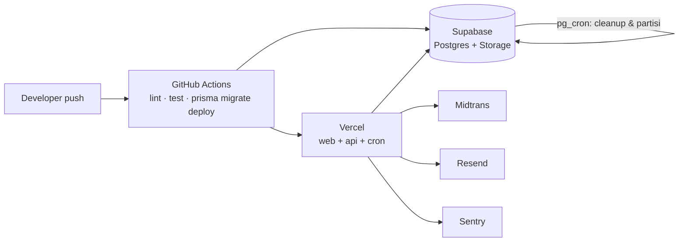

| Environment | Web | API | Database | Catatan |
|---|---|---|---|---|
| `local` | `pnpm dev` (Vite) | `pnpm dev:api` (localhost) | Supabase project `dev` (shared) | `MAIL=console`, `PAYMENT=fake`, `QUESTION_POOL=dev` |
| `preview` | Vercel Preview | Vercel Preview | **Supabase branch project** per PR (atau schema terpisah) | Migrasi otomatis saat PR dibuka |
| `staging` | Vercel | Vercel | Supabase `staging` | Midtrans sandbox, Resend test |
| `production` | Vercel | Vercel | Supabase `production` | Midtrans production, monitoring 24/7 |

### 16.1 Konfigurasi Vercel

- **API:** `apps/api` di-deploy sebagai Vercel Function dengan `maxDuration` 60 detik (Hobby) / 300 detik (Pro) untuk endpoint import dokumen; endpoint ujian ditargetkan < 2 detik.
- **Prisma di serverless:** satu instance `PrismaClient` di-global (`globalThis.__prisma`), `connection_limit=1`, `pool_timeout=10`, memakai **Supabase Pooler** (transaction mode, port 6543) untuk runtime; `DIRECT_URL` (port 5432) khusus migrasi.
- **Region:** function di `sin1` (Singapore) agar dekat Supabase; web di edge/region yang sama.
- **Bundle:** import berat (`sharp`, `unpdf`, `mammoth`) hanya di modul import/media sehingga tidak masuk cold start jalur ujian; gunakan dynamic import.
- **Cron:** `vercel.json` → `/api/v1/internal/cron/finalize-subtests` setiap 1 menit, `process-jobs` setiap 1 menit, `expire-subscriptions` harian, `cleanup` harian. Semua memakai `CRON_SECRET` (header `Authorization: Bearer`).
- **pg_cron (Supabase):** partisi tabel `proctoring_events`/`audit_logs`, hapus `rate_limit_hits` lama, refresh materialized view statistik.
- **Migrasi:** dijalankan GitHub Actions (`prisma migrate deploy` dengan `DIRECT_URL`) **sebelum** deploy Vercel; tidak pernah dari build Vercel (menghindari race multi-instance).

### 16.2 Batasan Serverless & Mitigasi

| Batasan | Dampak | Mitigasi |
|---|---|---|
| Function tanpa proses persisten | Tidak bisa memegang timer/memori | Semua state di Postgres; timer dihitung dari `ends_at`; cron 1 menit + lazy reconcile |
| Cold start | Latensi awal | Prisma singleton, dynamic import modul berat, region dekat DB, endpoint kecil |
| Batas eksekusi 60–300 detik | Import dokumen besar | Chunk per halaman/blok; `job_queue` resumable; commit per 500 baris |
| Body limit ~4,5 MB | Upload | Direct-to-Storage signed URL |
| Koneksi DB terbatas | Lonjakan koneksi | Pooler + `connection_limit=1` + query efisien (index, cursor pagination) |
| Cron tidak real-time | Subtes bisa telat terkunci hingga 60 detik | **Klien menerima `endsAt` absolut** dan mengunci UI sendiri tepat waktu; server menolak semua write setelah `ends_at`; cron hanya untuk finalisasi/skor |
| Batas concurrency function | Lonjakan 1.000 peserta | Throttle autosave per sesi, query ringan ber-index, `maxDuration` hanya dinaikkan pada endpoint import; load test wajib membuktikan 500 rps |

### 16.3 Observability

- Log JSON (pino) dengan `requestId`, `userId` (hash), `sessionId`, `subtestId`; dikirim ke Vercel log drain + Sentry.
- Metrik kunci: p95 per endpoint ujian, jumlah `409 EXAM_SUBTEST_LOCKED`, durasi cron, backlog `job_queue`, kegagalan webhook, error import dokumen.
- Alert: error rate > 1% (5 menit), cron gagal 2× berturut, backlog job > 1.000, webhook gagal > 5 dalam 10 menit.
- Runbook (`docs/runbook`): cron mati, subtes stuck `ACTIVE`, sesi ganda, DB connection saturation, restore PITR, force unlock.

---

## 17. Four-Branch Development Breakdown

**Aturan global:** Conventional Commits; PR < 400 LOC efektif; rebase harian ke `develop`; endpoint baru wajib punya Zod schema + entry Swagger + 1 test happy path & 1 error path.

### 17.1 Branch 1 — `dev/b1-foundation-identity`

**Tujuan:** fondasi teknis (monorepo, CI, Vercel config, observability, design system, kontrak, port) + domain identitas/otorisasi/platform.

| Item | Isi |
|---|---|
| Fitur | Registrasi + OTP/link, Google OAuth, reset password, profil, single-session + device mgmt, RBAC, audit log, settings platform, manajemen user, health, Swagger, error/timeout standard, email service, storage service, cron runner + `job_queue` worker-in-request |
| Modul backend | `core/*` (config, prisma, logger, filters, interceptors, guards, decorators, ports, jobs, cron, storage, mail, rate-limit), `auth`, `users`, `rbac`, `audit`, `health`, `internal/cron` |
| Frontend | `(auth)/login`, `register`, `verify`, `forgot`, `reset`; `(app)/+layout` + profil + devices; `(admin)/+layout` + dashboard shell + users + audit + settings; `lib/api/client.ts`; `lib/stores/auth`; `packages/ui` |
| DB | `core.prisma`: users, roles, permissions, role_permissions, auth_identities, sessions, verification_tokens, audit_logs, outbox_events, job_queue, rate_limit_hits, platform_settings + seed role, 3 stage, 4 subtes |
| API | Seluruh §12.1 + §12.5 |
| Eksternal | Google OAuth, Resend, Supabase Storage (avatar), Vercel Cron |
| Testing | Unit guard/policy/rate-limit; integration token rotation, unique active session, klaim job `SKIP LOCKED`, cron idempoten; E2E auth; Playwright auth flow |
| Dependency | Tidak ada (root) |
| Boleh diubah | root config (`package.json`, `turbo.json`, `pnpm-workspace.yaml`, `vercel.json`, `.github/**`, `.env.*.example`), `apps/api/src/core/**`, `apps/api/src/main.ts` + `api/index.ts`, `modules/{auth,users,rbac,audit,health,internal}/**`, `prisma/schema/core.prisma`, `prisma/migrations/*_b1_*`, `prisma/seed/**`, `apps/web/src/lib/{api,stores,auth}/**`, `(auth)/**`, `(app)/+layout.*`, `(admin)/+layout.*`, `packages/{ui,config}/**`, `packages/contracts/src/{common,auth,users,audit}/**` |
| Tidak boleh diubah | `modules/{questions,exams,billing}/**` (stub), `prisma/schema/{question,exam,billing}.prisma`, route `(app)/exam`, `(app)/subscription`, `(admin)/questions`, `(admin)/exams`, `(admin)/plans` |
| DoD | Auth+RBAC E2E hijau; sesi tunggal terbukti via test konkuren; cron endpoint idempoten & aman 2× paralel; audit tercatat untuk 5 aksi kritis; Swagger up; design system dipakai ≥ 1 halaman; coverage core 80% |

### 17.2 Branch 2 — `dev/b2-question-bank`

**Tujuan:** bank soal (termasuk 500 soal kecermatan & 140 pernyataan kepribadian), taksonomi, media, pipeline import spreadsheet **dan dokumen PDF/DOCX**.

| Item | Isi |
|---|---|
| Fitur | CRUD kategori/subkategori, CRUD 6 tipe soal, preview, media library + WebP, publish/archive/bulk action, cari & filter, coverage per subtes, import XLSX/CSV + ZIP, **import PDF & DOCX** (ekstraksi, parser, confidence, review UI, commit bertahap), dedupe, template download |
| Modul backend | `categories`, `questions`, `media`, `imports`, `imports/extractors/{pdf,docx,heuristic,ai}`, `questions/pool.service.ts` (impl `QuestionPoolPort`) |
| Frontend | `(admin)/questions` (virtual list, wizard, preview), `(admin)/categories`, `(admin)/media`, `(admin)/questions/import` (wizard: upload → parse → review side-by-side → commit), `lib/components/questions/**` (renderer registry: MCQ, Likert, MissingElement, PassHand) |
| DB | `question.prisma`: categories, questions, question_options, media_assets, question_media, import_jobs, import_job_errors, tags, question_tags |
| API | Seluruh §12.2 |
| Eksternal | Supabase Storage, `sharp`, `exceljs`, `papaparse`, `unpdf`, `mammoth`, `jszip`, opsional LLM |
| Testing | Unit dedupe + row validator + parser (fixture PDF 3 format & DOCX bergambar); integration import 5.000 baris + cancel + resume; Playwright import PDF & DOCX; gold set 20 dokumen dengan target ≥ 85% item ter-ekstraksi |
| Dependency | B1 (guard, `StoragePort`, `AuditPort`, `MailPort`, `job_queue`); `QuestionPoolPort` dibekukan Phase 0 |
| Boleh diubah | `modules/{categories,questions,media,imports}/**`, `prisma/schema/question.prisma`, `prisma/migrations/*_b2_*`, `(admin)/{questions,categories,media}/**`, `lib/components/questions/**`, `packages/contracts/src/{questions,categories,media,imports}/**` |
| Tidak boleh diubah | `core/**`, `app.module.ts`, `prisma/schema/{core,exam,billing}.prisma`, route B1/B3/B4, `packages/ui` |
| DoD | 6 tipe soal render benar di preview & runner (fixture); import 5.000 baris < 2 menit; import PDF/DOCX end-to-end dengan review & laporan error; tidak ada auto-publish; duplikat ditolak konsisten; 0 media yatim; `QuestionPoolPort` teruji; coverage 80% |

### 17.3 Branch 3 — `dev/b3-exam-engine`

**Tujuan:** mesin ujian paling kritis — 3 tes (Psikologi 4 subtes, TPA, TPK) dengan **hard lock & sistem gugur**, timer, autosave, proctoring, scoring, hasil, monitoring.

| Item | Isi |
|---|---|
| Fitur | Eligibility & start sesi, materialisasi per subtes, **buka subtes + hard lock**, autosave adaptif (Kecermatan & Pass Hand), resume, selesai lebih awal, gugur otomatis, batas 1 sesi/hari, 8 strategi skor, hasil per subtes + grafik Pass Hand, proctoring & policy, admin monitoring/void/recompute/force unlock |
| Modul backend | `exams` (session, subtest lifecycle, timer, finalize), `proctoring`, `scoring` (registry + strategies + `consistency`, `passhand`), `results` |
| Frontend | `(app)/exam` (gate, pemilihan subtes, runner per tipe, timer sticky, layar terkunci, layar gugur, reconnect banner), `(app)/results` (+grafik per subtes & kurva Pass Hand), `(app)/history`, `(admin)/exams` (konfigurasi 4 subtes), `(admin)/monitoring`, `lib/stores/examRunner.svelte.ts`, `lib/offline/answer-queue.ts` |
| DB | `exam.prisma`: exam_stages, subtests, exam_settings, exam_sessions, exam_session_stages, exam_session_subtests, exam_session_questions, exam_answer_events, proctoring_events, exam_violations |
| API | Seluruh §12.3 |
| Eksternal | Tidak ada (memakai `QuestionPoolPort`, `AccessPolicyPort`, `StoragePort`, `MailPort`) |
| Testing | Unit: timer/lock/gugur math, 8 strategi, konsistensi, stabilitas Pass Hand. Integration: finalisasi idempoten (10 request paralel), unique constraint, autosave race, resume, gugur mengunci subtes berikut. Playwright: 4 subtes penuh, refresh, timeout → lock, gugur, Kecermatan keyboard-only, Pass Hand 150 kolom. k6: autosave 500 rps. |
| Dependency | **B1** keras. **B2** gate G2 (`QuestionPoolPort` + pool 500/140/150); sebelum itu `MockQuestionPool` + fixture 760 soal. **B4** gate G3 (`AccessPolicyPort`); sebelum itu `DevAccessPolicy` |
| Boleh diubah | `modules/{exams,proctoring,scoring,results}/**`, `prisma/schema/exam.prisma`, `prisma/migrations/*_b3_*`, `(app)/{exam,results,history}/**`, `(admin)/{exams,monitoring}/**`, `lib/{stores/examRunner.svelte.ts,offline/**}`, `packages/contracts/src/{exams,results,proctoring}/**` |
| Tidak boleh diubah | `core/**` (kecuali membaca port), `prisma/schema/{core,question,billing}.prisma`, `modules/**` B1/B2/B4, `packages/ui`, `(admin)/{questions,plans}`, `app.module.ts` |
| DoD | 3 tes end-to-end (Psikologi 4 subtes, TPA, TPK; lulus & gugur) lulus E2E; hard lock terbukti (write setelah `ends_at` → 409, termasuk saat cron mati); tidak ada kebocoran `is_correct`/`dimension_map`; hasil deterministik dari snapshot; Kecermatan 500 soal stabil di 10 menit; k6 hijau; coverage 85% |

### 17.4 Branch 4 — `dev/b4-monetization`

| Item | Isi |
|---|---|
| Fitur | CRUD paket, pricing, checkout Midtrans Snap, status pembayaran, riwayat transaksi, langganan & riwayatnya, webhook terverifikasi + idempoten, expiry & reminder via cron, entitlement gating, admin transaksi/refund/mark-paid/extend/cancel, dashboard revenue |
| Modul backend | `plans`, `billing`, `payments` (abstraksi + Midtrans + webhook), `entitlements` (impl `AccessPolicyPort`), `analytics` (view read-only) |
| Frontend | `(app)/pricing`, `(app)/checkout`, `(app)/transactions`, `(app)/subscription`, `(admin)/plans`, `(admin)/transactions`, widget revenue di `(admin)/dashboard` |
| DB | `billing.prisma`: subscription_plans, subscriptions, subscription_events, transactions, payment_webhook_events, view `v_daily_revenue` |
| API | Seluruh §12.4 |
| Eksternal | Midtrans (sandbox/production), Resend, Vercel Cron |
| Testing | Unit price/stacking, signature, status mapping; integration replay webhook 3× → 1 aktivasi, dua webhook paralel, expired/failed, entitlement gate, cron expiry; Playwright checkout `FakeProvider`; fixture payload Midtrans asli |
| Dependency | **B1** keras (auth, RBAC, audit, mail, outbox, job_queue). `AccessPolicyPort` dikonsumsi B3 (gate G3) |
| Boleh diubah | `modules/{plans,billing,payments,entitlements,analytics}/**`, `prisma/schema/billing.prisma`, `prisma/migrations/*_b4_*` (+ view), `(app)/{pricing,checkout,transactions,subscription}/**`, `(admin)/{plans,transactions}/**` + `dashboard/RevenueWidget.svelte`, `packages/contracts/src/{billing,plans}/**` |
| Tidak boleh diubah | `core/**`, `prisma/schema/{core,question,exam}.prisma`, `modules/**` B1–B3, `packages/ui`, route ujian |
| DoD | Pembayaran sandbox → langganan aktif → bisa ujian; webhook replay aman; signature invalid ditolak; stacking benar; refund tidak menghapus riwayat; dashboard < 1 detik pada 100k baris; coverage 80% |

### 17.5 Matriks Kepemilikan File

| Area | Owner | Branch lain |
|---|---|---|
| `apps/api/src/core/**` (kecuali `ports/*`) | B1 | Baca saja |
| `core/ports/*.ts` | per-domain (identity→B1, question→B2, exam/access→B3, payment→B4) | Implementasi, tidak edit |
| `core/ports/ports.module.ts` | **Integrator** | 1 baris/PR + review |
| `app.module.ts`, `api/index.ts`, `vercel.json` | **Integrator** (Phase 0 lengkap) | Tidak |
| `prisma/schema/{core,question,exam,billing}.prisma` | B1/B2/B3/B4 | Tidak |
| `prisma/migrations/*_b{n}_*` | branch n | Generate via script saja |
| `packages/ui/**` | B1 | Tidak (ajukan PR) |
| `packages/contracts/src/<domain>/**` | branch domain | Tidak |
| `packages/contracts/src/index.ts` | **tidak ada** — subpath export | — |
| `.github/**`, root config, `supabase/**` | B1 | Integrator untuk pipeline gabungan |
| `CODEOWNERS` | **Integrator** | Tidak |
| `docs/adr/**` | siapa pun (satu file per ADR) | — |

**Anti-konflik:** (1) subpath export tanpa barrel; (2) migrasi berprefix `..._b{n}_`; (3) `prisma/seed/index.ts` memindai `seeds/`; (4) test per branch di `test/<domain>/`; (5) CI path filter `turbo run test --filter=...[origin/develop]`.

---

## 18. Integration Strategy

### 18.1 Branch Dependency & Gate

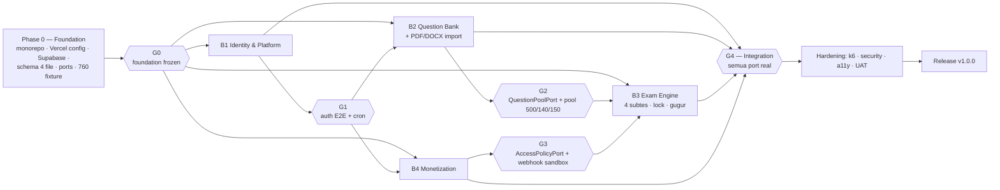

**Merge order ke `develop`:** Phase 0 → B1 → (B2 ∥ B4) → B3 → integrasi. B3 tetap coding sejak minggu 2 dengan mock.

### 18.2 Mock Sebelum Dependency Siap

| Kebutuhan B3 | Mock (sampai gate) | Implementasi nyata |
|---|---|---|
| Soal | `MockQuestionPool` + `packages/mocks/fixtures/` berisi **760 soal** (100 Kecerdasan + 140 Kepribadian berpasangan + 500 Kecermatan + 20 kolom Pass Hand) | `PrismaQuestionPool` (B2) |
| Akses ujian | `DevAccessPolicy` (selalu lolos, bisa dipaksa gagal) | `BillingAccessPolicy` (B4) |
| Media | `DevStorage` (placeholder signed URL) | `SupabaseStorage` (B1) |
| Email | `ConsoleMail` | `ResendMail` (B1) |
| Pembayaran (B4) | `FakeProvider` + `/internal/payments/fake/settle` | `MidtransProvider` |
| Cron | `pnpm cron:run` (loop lokal memanggil endpoint internal) | Vercel Cron |
| Frontend tanpa API | MSW dari kontrak (`pnpm dev:web --mock`) | API nyata |

### 18.3 Contract-First

1. Phase 0 menetapkan `packages/contracts`: envelope, error codes, pagination, port interfaces, skeleton Zod per domain.
2. Perubahan kontrak = RFC (`docs/rfc/<tanggal>-<topik>.md`) berisi diff Zod + OpenAPI + dampak lintas branch, disetujui integrator + owner domain.
3. CI membandingkan `openapi.json` dengan `develop`: breaking change gagal kecuali label `contract:breaking` + kenaikan versi minor.
4. `pnpm gen:api` memecah tipe generated per tag; frontend tidak boleh menulis tipe payload manual.

### 18.4 Database Migration Ownership

- Satu file migrasi hanya menyentuh tabel milik branch. Perubahan lintas domain = RFC, **owner yang menulis**.
- Nama: `YYYYMMDDHHMMSS_b{n}_{verb}_{subject}`.
- Selama fase paralel hanya **additive** (`ADD COLUMN NULL`, `CREATE TABLE`, `CREATE INDEX CONCURRENTLY`). `RENAME`/`DROP`/`SET NOT NULL` ditunda ke Phase 2.
- `scripts/db-guard.mjs` memeriksa prefix, `prisma migrate diff` bersih, dan menolak `ALTER TABLE` ke tabel branch lain.
- Migrasi dijalankan GitHub Actions dengan `DIRECT_URL` (port 5432) ke Supabase, **sebelum** deploy Vercel.

### 18.5 Environment & Testing Sebelum Merge

- `.env.shared.example` + `.env.example` per branch; `pnpm env:check` memvalidasi dengan Zod; CI gagal bila variabel hilang.
- Setiap PR: lint → typecheck → unit → integration (Supabase branch project) → build → `db-guard` → OpenAPI diff → smoke E2E domain.
- Review: 1 owner domain + 1 integrator untuk kontrak/migrasi/`ports.module.ts`.

### 18.6 Definition of Done Integrasi (Gate G4)

- Semua port memakai implementasi nyata; tidak ada `dev`/`fake` di staging.
- E2E lintas branch: registrasi → verifikasi → beli paket (sandbox) → Psikologi 4 subtes → (lulus/gugur) → TPA → TPK → hasil → riwayat → admin melihat transaksi, hasil, dan pelanggaran.
- `openapi.json` final; tidak ada breaking diff tak tercatat.
- Migrasi bersih dari DB kosong **dan** dari snapshot produksi (upgrade path).
- Cron terpasang di Vercel dan terbukti idempoten (simulasi 2 instance paralel).
- k6 1.000 VU hijau; error rate < 0,1%; p95 sesuai NFR.
- Security review lulus; tidak ada TODO/FIXME kritis; runbook & ADR lengkap.

### 18.7 Resolusi Konflik

- Rebase harian; PR kecil; feature flag (`FF_EXAM_ENGINE`, `FF_BILLING`, `FF_DOC_IMPORT`).
- Konflik pada file non-whitelist = pelanggaran kepemilikan → eskalasi integrator.
- Konflik migrasi: regenerasi di branch integrator, bukan edit file yang sudah di-merge.

---

## 19. Milestones

| Milestone | Durasi | Deliverable | Exit criteria |
|---|---|---|---|
| **M0 — Foundation** | 1 minggu | Phase 0: monorepo, Vercel config, Supabase project, 4 schema, migrasi baseline, `core` skeleton, ports + mock 760 soal, `packages/ui`, cron runner, seed runner, env check, db-guard | G0: CI hijau, `pnpm dev` + `pnpm dev:api` jalan, mock server jalan, `vercel build` sukses |
| **M1 — Core Domains** | 2 minggu | B1 auth penuh + cron; B2 CRUD 6 tipe soal + media; B4 paket + checkout FakeProvider; B3 session skeleton + subtest lifecycle (mock pool) | G1: login → dashboard; soal dibuat; subtes bisa dibuka & terkunci dengan mock |
| **M2 — Feature Complete** | 3 minggu | B2 import spreadsheet + **PDF/DOCX** + review UI; B3 4 subtes Psikologi + TPA + TPK + lock + gugur + 8 strategi + proctoring; B4 webhook Midtrans + entitlement + admin grant langganan | G2/G3: 3 tes selesai dengan pool nyata; pembayaran sandbox & grant manual mengaktifkan langganan |
| **M3 — Integration** | 1 minggu | Swap mock → real, `app.module` final, cron produksi, E2E lintas branch, OpenAPI final, migrasi upgrade path | G4 |
| **M4 — Hardening** | 1–2 minggu | Security review, k6 1.000 VU (fokus autosave Kecermatan), a11y, observability, runbook, UAT 20 pilot | Error rate < 0,1%; p95 sesuai NFR; 0 temuan kritis |
| **M5 — Launch** | 3–5 hari | Migrasi produksi, seed soal final (**≥ 760 Psikologi + TPA + TPK**), verifikasi Midtrans production, monitoring 72 jam | v1.0.0 |

Total **10–12 minggu** untuk 4 workstream paralel. Critical path: **B1 → B2 (pool 500 Kecermatan) → B3 → Integration**. Risiko jadwal terbesar: penyediaan bank soal, bukan kode.

### 19.1 Risiko Utama

| Risiko | Dampak | Mitigasi |
|---|---|---|
| Pool soal < kebutuhan subtes | Subtes tidak bisa dimulai / soal berulang | `pool.service` memblokir start dengan `EXAM_POOL_INSUFFICIENT` + dashboard coverage; mock 760 soal sejak Phase 0 |
| Ekstraksi PDF/DOCX buruk | Admin tidak memakai fitur | Heuristic + confidence + review wajib; gold set 20 dokumen; target 85% diumumkan jujur |
| Bug timer/lock | Ujian tidak adil / bisa diakali | Test idempoten + paralel, fake clock, k6 jalur `reconcile` |
| Kecermatan 500 soal berat | Frame drop / jawaban hilang | 500 soal dimaterialisasi & diprefetch, render 1 soal, IndexedDB queue, batch 50 jawaban / 2 detik |
| Serverless cold start di jam ujian | Lonjakan latensi | Prisma singleton, region sama, dynamic import, warming opsional sebelum jadwal |
| Webhook double-processing | Langganan salah | Unique index + `FOR UPDATE` + replay test |
| Scope creep psikotes lanjutan | Jadwal | Registry strategi + `MANUAL_REVIEW`; fitur lanjutan fase 2 |

---

## 20. Keputusan Terbuka & Catatan Angka Soal

| Topik | Rekomendasi | Alasan |
|---|---|---|
| Penentuan gugur | **Per subtes** (`percentage < passing_score` → `ELIMINATED`) | Sesuai permintaan "sistem gugur"; admin bisa menonaktifkan per subtes |
| Kebijakan waktu saat gugur | Subtes berikut langsung `LOCKED`, sesi `COMPLETED` dengan status `ELIMINATED` | Mencegah user menunggu/mencoba lagi di hari yang sama |
| Unlock | Hanya `SUPER_ADMIN`, wajib alasan, tercatat audit, dan **tidak** mengembalikan waktu | Menjaga integritas sekaligus memberi jalur darurat |
| Transisi subtes | Default `on_open` (timer mulai saat dibuka) | Adil untuk gangguan jaringan; admin bisa pilih `immediate` |
| Grace period | 3 detik (subtes ≤ 15 menit) / 8 detik (subtes panjang) | Toleransi RTT tanpa membuka celah |
| Kepribadian | Konfirmasi: **5 skala Likert** (SS/S/R/TS/STS) | Sesuai spesifikasi |
| Konsistensi kepribadian | Flag + skor indeks; **tidak** otomatis gugur | Menghindari penalti salah (jawaban konsisten rendah ≠ bohong) |
| Pass Hand | 150 kolom × 20 baris, 18 menit (range 15–20) | Sesuai spesifikasi; dapat diubah admin |
| Kecermatan | 500 soal, penalti salah 1, kosong 0, tanpa tuntutan selesai | Sesuai spesifikasi |
| Import DOC (lama) | Tidak didukung | Butuh LibreOffice; minta konversi ke DOCX |
| AI extraction | Opsional, mati secara default | Biaya & privasi |
| Hosting | Vercel (web + API + cron), Supabase (Postgres + Storage) | Sesuai permintaan; tanpa Docker |
| Antrian/cron | Vercel Cron + `job_queue` + pg_cron | Tidak ada Redis/worker |
| Bahasa & zona waktu | UI Indonesia, `Asia/Jakarta`, Rupiah, `id-ID` | Pasar target |
| Captcha | Turnstile setelah 3 kegagalan | Tanpa friction untuk pengguna normal |

**Angka soal (default; "±760 soal" = 740 item bank statis + 20 template Pass Hand):**

| Komponen | Jumlah | Durasi | Catatan |
|---|---|---|---|
| Kecerdasan | 100 soal | 120 menit | 33 verbal, 34 praktis/numerik, 33 logis |
| Kepribadian | 140 soal | 45 menit | 120 item unik + 10 pasangan jebakan (20 item) |
| Kecermatan | 500 soal | 10 menit | 3 varian (angka/huruf/simbol), ±166 per varian |
| **Subtotal bank statis** | **740 soal** | 175 menit | Inilah yang benar-benar disimpan sebagai item di DB |
| Pass Hand | 20 template → **150 kolom per sesi** | 18 menit | Dibangkitkan prosedural per sesi; bukan item bank |
| **Total materi Psikologi** | **±760** | **± 3 jam 13 menit** | 740 item + 20 template; di luar TPA & TPK |

> **Catatan angka:** bila 150 kolom Pass Hand ikut dihitung sebagai item, total tercatat menjadi 890 (100 + 140 + 500 + 150). Angka **±760** adalah target yang dipakai di dokumen ini dan konsisten dengan desain "Pass Hand prosedural". Jika kebijakan berubah menjadi Pass Hand statis, cukup ubah `question_count` Pass Hand dan seed 150 kolom — tidak ada perubahan skema.

---

## 21. Langkah Berikutnya

1. **Phase 0** dikerjakan satu integrator (`dev/b1-foundation-identity`, sub-task foundation) → tag `v0.1.0-foundation`.
2. Setelah G0, tiga branch lain mulai paralel sesuai §17 dengan mock 760 soal.
3. Integrasi mengikuti gate G1–G4 (§18), lalu hardening, lalu launch.
4. **Paralel non-kode (mulai hari 1):** penyediaan bank soal 760 butir (Psikologi) + bank soal TPA & TPK, karena ini penentu jadwal.

### 21.1 Checklist Phase 0 (Foundation)

- [ ] Monorepo pnpm + Turborepo, tsconfig/eslint shared, CI dasar
- [ ] Supabase project dev + branch project untuk preview; **tanpa Docker**
- [ ] Vercel project (web + api) + `vercel.json` (rewrite `/api/*`, cron, `maxDuration`)
- [ ] NestJS skeleton: config (Zod), logger (pino), filters, interceptors, guards stub, Swagger, Prisma singleton
- [ ] `api/index.ts` (serverless entry) + `@sveltejs/adapter-vercel`
- [ ] Prisma multi-file + migrasi baseline (core/question/exam/billing) + seed 3 stage & 4 subtes
- [ ] `packages/contracts`: envelope, error codes, pagination, port interfaces, OpenAPI skeleton, subpath exports
- [ ] `packages/mocks`: MSW + fixture **760 soal** (termasuk pasangan Kepribadian, Kecermatan, kolom Pass Hand)
- [ ] `packages/ui`: design token + 10 komponen dasar
- [ ] `job_queue` + `outbox_events` + cron runner + `pnpm cron:run` (lokal)
- [ ] Rate limit Postgres (token bucket) + guard
- [ ] Seed runner (auto-scan `seeds/`), `env:check`, `db-guard`
- [ ] Template PR, CODEOWNERS, label `contract:breaking`, ADR-0001 (arsitektur), ADR-0002 (kepemilikan), ADR-0003 (tanpa Redis/worker)
- [ ] SvelteKit skeleton: route group `(auth)`, `(app)`, `(admin)`, `hooks.server.ts` stub
